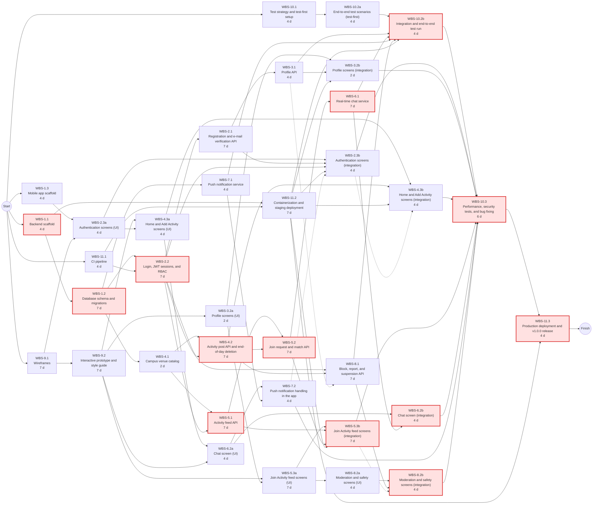
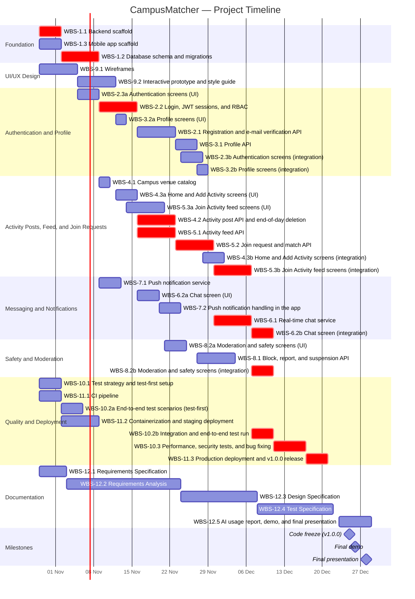

# Software Engineering — Project Plan

## Cover Page

| Field | Details |
|---|---|
| **Course** | BLG411E Software Engineering |
| **Report name** | Project Plan |
| **Project title** | CampusMatcher |
| **Group name / number** | Group B.B.F |
| **Group members** | Enes Durukan — 150230100, Erinç Özarı — 150190060, Mohammed Alashi — 150240935, Ali Çetin — 150190741, İbrahim Meral — 150220101 |
| **Instructor** | Prof. Dr. Tolga Ovatman, Assoc. Prof. Dr. Ayşe Tosun |
| **Submission date** | 2026-10-20 |
| **Document version** | 1.1 |
| **Revision** | 1.1 (2026-10-29): schedule re-levelled after customer feedback (all dependencies shown, mobile tasks split into UI and integration, no parallel development tasks per member), app opened to all İTÜ members, end-of-day deletion of activities and chats, AI agents reduced to two. |

---

## 1. Introduction

### 1.1 Scope

**Project overview:**
Members of Istanbul Technical University (İTÜ), both students and staff, often skip campus activities such as studying at the library, working out at the gym, or eating at the cafeteria because they have no one to go with. CampusMatcher is a mobile application (Android and iOS) developed specifically for the İTÜ community to solve this problem. Only users with a verified İTÜ e-mail address (`@itu.edu.tr`), students or staff, can register, and the venue list contains İTÜ campus locations (e.g., the Mustafa İnan Library, campus gyms, and cafeterias). The application has two main actions on its home screen. With **Add Activity**, a user publishes an activity post with an activity category, a campus venue chosen from a predefined list, a planned date, and a time window (e.g., *Library, 30 October, 19:00–23:00*). With **Join Activity**, a user browses a social-media-style feed of all active posts, filters it by activity and hour, opens a post to see its details, and sends the post owner a join request with a message. When the owner accepts the request, the two users are matched: the post is closed and no longer shown in the feed, and they agree on the exact meeting point in the chat that belongs to the activity. At the end of each day, all activities planned for that day are deleted automatically together with their chats; activities planned for later days are kept (e.g., at the end of 30 October, a post for 3 November created on 30 October stays). The application has no swipe-based matching and no friend system; a match belongs to a single post only. System administrators moderate the platform by reviewing user reports and suspending accounts.

**In scope:**
- User registration restricted to verified İTÜ e-mail addresses (`@itu.edu.tr`) of students and staff, login, and token-based sessions.
- Role-based authorization for members (students and staff) and administrators.
- User profile management (profile information, faculty/department, interests, activity preferences).
- Home screen with the two main actions: Add Activity and Join Activity.
- Activity posts (Add Activity): creating, editing, and deleting posts with an activity category, a campus venue selected from a predefined list, a planned date, a time window, and an optional short note.
- Activity feed (Join Activity): a feed of all open posts of other users with their details, filterable by activity category and hour (and venue).
- Join requests and matching: a user sends a join request with a message to the post owner; the owner accepts or declines it. An accepted request is a match, and the matched post is closed and no longer shown in the feed.
- Text-based in-app messaging between the post owner and the requesting user; the chat belongs to the activity, and the exact meeting point is agreed in it.
- End-of-day deletion: every day at 23:59, all activities planned for that day are deleted automatically together with their join requests and chats; activities planned for later days are kept.
- Push notifications for new join requests, request responses, and new messages.
- Safety and moderation: blocking and reporting users, and admin-only screens to review reports and suspend accounts.
- A service-based backend offering a REST API, hosted on a cloud platform with a relational database, with a CI/CD pipeline.

**Optional scope:**
- Group matching: a post owner sets a capacity of more than two participants, and the post stays in the feed until it is full.
- Basic usage statistics for administrators (e.g., most popular venues and time slots).

**Out of scope:**
- GPS and device location services, including real-time location tracking, live location sharing, map views, and distance-based matching.
- A friend system (friend requests, adding or removing friends, friend lists) or any other persistent social connection between users.
- Keeping activities or chats after the end of their planned day (no activity or chat history).
- Dating or romantic matching features.
- Voice and video calling.
- Integration with official university systems (student information system, campus card, facility reservation systems).
- Payment, in-app purchase, or monetization features.
- Multi-university (multi-tenant) support.
- A full-featured web client for users (the user interface is a mobile application).
- Publishing the application to the Google Play Store or Apple App Store.

**Assumptions and constraints:**
- **Team:** Five members. One man-week is defined as 40 hours. Each member is available about 20 hours per week (0.5 FTE): at most 0.4 FTE for development activities and 0.1 FTE for documentation and meetings.
- **Time:** Development runs from 2026-10-29 to 2026-12-20. The code freeze is on 2026-12-25 (release `v1.0.0` on `main`), the final demo is on 2026-12-26, and the final presentation is in the week of 2026-12-28. Document deadlines are fixed by the course schedule. The midterm exam (week of 2026-11-23) and other courses reduce availability around that time.
- **Budget:** There is no budget. Only free tiers are used: Neon PostgreSQL, a free cloud hosting tier (Render or Azure for Students), Firebase Cloud Messaging, and Expo.
- **Technology:** Python/FastAPI backend, React Native (Expo) mobile application, PostgreSQL database, JWT authentication, GitHub Actions for CI/CD.
- **Process:** All work is tracked as GitHub issues on the project board. Nobody commits directly to `main`; every change goes through a pull request with at least one approval. A test-first approach is followed.
- **AI agents:** Two AI agents are used as assistants: **Claude Code** for coding, testing, and documentation, and **ChatGPT** for image creation and design. Every AI-generated output is reviewed by a team member in a pull request, and AI usage, effort, introduced errors, and their fixes are reported.
- **Domain:** The campus venue list is predefined and stored as seed data; no location data is collected from devices. The application is for all İTÜ members (students and staff): e-mail addresses are checked by the `@itu.edu.tr` domain, and the venue list contains only İTÜ campus locations. The customer (TA) may change requirements; every request is recorded as a `customer-requests` issue within 48 hours.

### 1.2 Deliverables

| Deliverable ID | Deliverable name | Description / contents | Acceptance criterion |
|---|---|---|---|
| D-01 | CampusMatcher mobile application | React Native (Expo) application for Android and iOS with authentication, profile, home (Add Activity / Join Activity), activity feed, join request, chat, notification, and moderation screens. | All in-scope user flows can be completed on an Android and an iOS device against the deployed backend during the final demo. |
| D-02 | Backend API services | FastAPI REST API and WebSocket service for authentication, profiles, venues, activity posts, the activity feed, join requests and matches, messaging, notifications, and moderation. | All endpoints are documented (OpenAPI) and pass their unit and integration tests in CI. |
| D-03 | Database | Neon PostgreSQL schema, Alembic migrations, and venue seed data. | Migrations run on an empty database without errors, and the seed data loads successfully. |
| D-04 | CI/CD pipeline and cloud deployment | GitHub Actions workflow, Docker image, staging and production environments. | Every pull request runs lint and tests automatically; the production API is reachable, and release `v1.0.0` is published on `main` by 2026-12-25. |
| D-05 | Automated test suite | Unit, integration, end-to-end, performance, and security tests in the `tests/` folder. | All tests pass on the release; backend line coverage is at least 70%; no open critical defect remains. |
| D-06 | UI/UX design package | Wireframes, an interactive prototype, and a style guide. | Approved by the team and presented to the customer; implemented screens follow the style guide. |
| D-07 | Project documentation | Project Charter, Project Plan, Requirements Specification, Requirements Analysis, Design Specification, Test Specification, AI usage report, README, and final presentation. | Each document is released on time with the required release name, and all review comments are resolved before the next deadline. |

### 1.3 Functional Requirements / Tasks

| Task ID | Functional requirement / task | Description | Related deliverable ID(s) |
|---|---|---|---|
| T-01 | System foundation | Backend and mobile project scaffolds and the database schema that all features build on. | D-01, D-02, D-03 |
| T-02 | Registration, authentication, and authorization | İTÜ members (students and staff) register with a verified `@itu.edu.tr` e-mail address and log in; the system issues tokens and restricts endpoints by role (member, admin). | D-01, D-02, D-03 |
| T-03 | Profile management | Users view and update their profile information, faculty/department, interests, and activity preferences. | D-01, D-02 |
| T-04 | Activity posts (Add Activity) | Users publish, edit, and delete activity posts with a category, a campus venue from the predefined list, a planned date, and a time window; at the end of each day, the activities planned for that day are deleted automatically. | D-01, D-02, D-03 |
| T-05 | Activity feed and join requests (Join Activity) | Users browse and filter the feed of open posts and send join requests; post owners accept or decline them. An accepted request is a match, and the matched post is closed and no longer shown in the feed. | D-01, D-02 |
| T-06 | In-app messaging | The post owner and the requesting user chat in real time, starting with the join request message, to agree on the exact meeting point; the chat belongs to the activity and is deleted with it at the end of its planned day. | D-01, D-02 |
| T-07 | Push notifications | Users receive notifications for new join requests, request responses, and new messages. | D-01, D-02 |
| T-08 | Safety and moderation | Users block and report other users; administrators review reports and suspend accounts. | D-01, D-02 |
| T-09 | UI/UX design | Wireframes, prototype, and style guide for all screens. | D-06, D-01 |
| T-10 | Testing and quality assurance | Test strategy, test-first setup, integration, end-to-end, performance, and security testing. | D-05 |
| T-11 | CI/CD and deployment | Continuous integration, containerization, staging and production deployment, and the final release. | D-04 |
| T-12 | Documentation and reporting | Course documents, AI usage report, demo, and final presentation. | D-07 |

### 1.4 Non-functional Issues

| Quality attribute | Requirement / concern | How it will be assessed |
|---|---|---|
| Security | Only verified İTÜ e-mail addresses (`@itu.edu.tr`) of students and staff can register. Passwords are stored hashed (bcrypt); all traffic uses HTTPS; JWT access tokens expire; admin endpoints are restricted by role; users can only read the chats of activities they take part in. | Automated authorization tests (missing, expired, and wrong-role tokens), input validation tests, and a security checklist review in WBS-10.3. |
| Performance | API responses within 500 ms (95th percentile) with 100 concurrent users; the feed loads and applies filters within 1 second with 500 active posts; chat messages are delivered within 2 seconds. | Load tests on the staging environment (e.g., Locust) and timing assertions in integration tests (WBS-10.3). |
| Usability | A user can publish an activity post in under 30 seconds and in at most two screens, and can find a suitable post in the feed with at most two filter selections. The interface follows a consistent style guide with readable text and sufficient color contrast. | Usability test with at least five İTÜ members using the prototype (WBS-9.2) and the final application (WBS-10.3). |
| Reliability | The service is available during the demo; the chat reconnects automatically after a network loss; the end-of-day deletion runs on time even after a server restart. | End-to-end tests (WBS-10.2b), reconnect tests, and monitoring of the staging environment. |
| Privacy | No GPS or device location is collected; only the selected campus venue is stored. Blocked users cannot see or contact the blocking user. Only necessary personal data is stored, and activities and chats are deleted at the end of their planned day, so no activity or chat history is kept. | Data-model review in the Design Specification, and moderation and deletion tests in WBS-10.2b. |
| Maintainability | Every change is reviewed in a pull request; backend test coverage is at least 70%; code follows a shared lint configuration. | CI coverage report and lint checks on every pull request. |

---

## 2. Project Plan — Work Breakdown Structure (WBS)

Each task in Section 1.3 is broken down into subtasks. Sizes use the five-level scale:

**T = Tiny · S = Small · M = Medium · L = Large · XL = Extra-large**

| WBS activity ID | Parent task ID | Activity / subtask | Description / completion condition | Size (T/S/M/L/XL) |
|---|---|---|---|---|
| WBS-1.1 | T-01 | Backend scaffold | FastAPI project structure, configuration, health-check endpoint, and Pytest setup. Done when the service starts locally and the health-check test passes in CI. | S |
| WBS-1.2 | T-01 | Database schema and migrations | Tables for users, venues, activity posts, join requests, matches, messages, device tokens, blocks, and reports on Neon PostgreSQL with Alembic migrations. Done when migrations run on a clean database and model tests pass. | M |
| WBS-1.3 | T-01 | Mobile app scaffold | Expo + TypeScript project, React Navigation skeleton, Axios API client, and Jest setup. Done when the app runs on Android and iOS (Expo Go) and a sample test passes. | S |
| WBS-2.1 | T-02 | Registration and e-mail verification API | Sign-up restricted to İTÜ e-mail addresses (`@itu.edu.tr`, for both students and staff), verification e-mail with a one-time code, and password hashing. Done when unverified or non-İTÜ accounts are rejected in tests. | M |
| WBS-2.2 | T-02 | Login, JWT sessions, and RBAC | Login endpoint, access/refresh tokens, and role-based authorization middleware (member, admin). Built first so that all other services can use the same authorization check. Done when protected endpoints reject missing, expired, or wrong-role tokens in tests. | M |
| WBS-2.3a | T-02 | Authentication screens (UI) | Register, verify-code, and login screens with form validation, built with mock data against the agreed API contract. Done when the screens pass their component tests. | S |
| WBS-2.3b | T-02 | Authentication screens (integration) | Connects the screens to the registration and login API and stores tokens securely on the device. Done when a user can register, verify, and log in against the staging API. | S |
| WBS-3.1 | T-03 | Profile API | Endpoints to view and update profile information, faculty/department, interests, and activity preferences. Done when CRUD and validation tests pass. | S |
| WBS-3.2a | T-03 | Profile screens (UI) | Profile view and edit screens with preference selection, built with mock data. Done when the screens pass their component tests. | T |
| WBS-3.2b | T-03 | Profile screens (integration) | Connects the profile screens to the profile API. Done when profile changes are saved and shown again after reopening the app. | T |
| WBS-4.1 | T-04 | Campus venue catalog | Predefined list of İTÜ campus venues per activity category (library, gym, cafeteria) with seed data and a read-only endpoint. Done when the venues can be listed by category. | T |
| WBS-4.2 | T-04 | Activity post API and end-of-day deletion | Create, edit, and delete activity posts (category, venue, planned date, time window, optional short note) with validation of past and overlapping time windows, and an end-of-day job: every day at 23:59, all posts planned for that day are deleted together with their join requests and chats, while posts planned for later days are kept. Done when all post rules and the end-of-day job are covered by passing tests. | M |
| WBS-4.3a | T-04 | Home and Add Activity screens (UI) | Home screen with the two main actions (Add Activity, Join Activity) and the Add Activity flow (category, venue, date, time window), built with mock data. Done when the flow passes its component tests. | S |
| WBS-4.3b | T-04 | Home and Add Activity screens (integration) | Connects the Add Activity flow to the post API and lists, edits, or deletes the user's own posts. Done when a post created in the app appears in the feed. | S |
| WBS-5.1 | T-05 | Activity feed API | Endpoint that lists the open posts of other users, newest first, with filters for activity category, time (hour range), and venue, and with pagination; posts of blocked users are hidden. Done when filter and pagination tests pass. | M |
| WBS-5.2 | T-05 | Join request and match API | A user sends a join request with a message to the post owner; the owner accepts or declines it. An accepted request is a match: the post is closed and no longer shown in the feed, and it is deleted with its chat by the end-of-day job (WBS-4.2). Done when every request state is tested. | M |
| WBS-5.3a | T-05 | Join Activity feed screens (UI) | The main feed screen (social-media-style list of posts with their details), filter controls for activity and hour, the post detail screen with the join request message, and the owner's request inbox with accept/decline, built with mock data. Done when all screens and states pass their component tests. | M |
| WBS-5.3b | T-05 | Join Activity feed screens (integration) | Connects the feed, filters, join requests, and the request inbox to the feed and join request APIs. Done when a user can find a post with filters, send a request, and get accepted on the staging API. | M |
| WBS-6.1 | T-06 | Real-time chat service | WebSocket chat between a post owner and a requesting user: the chat belongs to the activity, starts with the join request message, continues after the match, and is deleted together with the activity at the end of its planned day. Done when messages are delivered in real time in integration tests. | L |
| WBS-6.2a | T-06 | Chat screen (UI) | Chat screen between the post owner and the requesting user, built with mock messages. Done when the screen passes its component tests. | S |
| WBS-6.2b | T-06 | Chat screen (integration) | WebSocket client with reconnect handling, connected to the chat service. Done when two devices exchange messages through the staging server. | S |
| WBS-7.1 | T-07 | Push notification service | Firebase Cloud Messaging integration, device-token storage, and a notification sender; join requests, request responses, and messages call this sender when they are implemented (WBS-5.2, WBS-6.1). Done when a test notification reaches a registered device. | S |
| WBS-7.2 | T-07 | Push notification handling in the app | Device token registration and opening the related screen when a notification is tapped. Done when notifications arrive on a test device. | S |
| WBS-8.1 | T-08 | Block, report, and suspension API | Blocking users (their posts are hidden from the feed and they cannot send requests or messages), reporting users or posts, and admin endpoints to review reports and suspend accounts. Done when blocked users can no longer see or contact the blocking user in tests. | M |
| WBS-8.2a | T-08 | Moderation and safety screens (UI) | Block and report actions for users, plus admin-only screens to review reports and suspend accounts, built with mock data. Done when the screens pass their component tests. | S |
| WBS-8.2b | T-08 | Moderation and safety screens (integration) | Connects the safety actions and admin screens to the moderation API. Done when an admin can suspend a reported user from the app. | S |
| WBS-9.1 | T-09 | Wireframes | Low-fidelity wireframes for all core screens and the main user flows. Done when the team reviews and approves the wireframes. | M |
| WBS-9.2 | T-09 | Interactive prototype and style guide | Clickable prototype, color/typography style guide, icons and visual assets, and a reusable component list. Done when the prototype is shown to the customer and feedback is recorded. | M |
| WBS-10.1 | T-10 | Test strategy and test-first setup | Test strategy, Pytest/Jest configuration, coverage reporting, and the rule that every PR includes tests. Done when coverage is reported on every PR. | S |
| WBS-10.2a | T-10 | End-to-end test scenarios (test-first) | End-to-end test scenarios and test data for the main flow (register → create post → join request → match → chat → block/report → end-of-day deletion), written from the user stories in the Requirements Specification before the features exist. Done when the scenarios are reviewed and committed as failing tests. | S |
| WBS-10.2b | T-10 | Integration and end-to-end test run | Completes and runs the integration and end-to-end tests against the staging environment. Done when the full flow passes on staging. | S |
| WBS-10.3 | T-10 | Performance, security tests, and bug fixing | Load test of the feed and chat endpoints, security checks (authorization, input validation), and fixing found defects. Done when no open critical bug remains. | L |
| WBS-11.1 | T-11 | CI pipeline | GitHub Actions workflow running lint and tests on every pull request; branch protection on main. Done when a failing test blocks a PR. | S |
| WBS-11.2 | T-11 | Containerization and staging deployment | Docker image for the backend, a staging environment on the cloud platform with Neon PostgreSQL, and automatic deployment from main. It is set up early, so every merged feature is deployed to staging. Done when the staging health-check endpoint is reachable by the mobile app. | M |
| WBS-11.3 | T-11 | Production deployment and v1.0.0 release | Production configuration, final deployment, and the v1.0.0 release on main. Done when the release is published and the demo runs from it. | S |
| WBS-12.1 | T-12 | Requirements Specification | User stories with acceptance criteria and use cases; released as `requirements-spec-v1.0` by 2026-11-02. | M |
| WBS-12.2 | T-12 | Requirements Analysis | Data models, behavioral models, prototypes, and wireframes; released as `requirements-analysis-v1.0` by 2026-11-23. | M |
| WBS-12.3 | T-12 | Design Specification | Architecture, API, and database design; released as `design-spec-v1.0` by 2026-12-07. | M |
| WBS-12.4 | T-12 | Test Specification | Test plan and test cases; released as `test-spec-v1.0` by 2026-12-21. | M |
| WBS-12.5 | T-12 | AI usage report, demo, and final presentation | AI usage report, demo scenario from `v1.0.0`, and the final presentation by 2026-12-28. | S |

**WBS decomposition notes:**
- Every feature is split into a **backend activity** (API and business logic) and **mobile activities** (screens). Each mobile activity has two parts: a **UI part (a)** built with mock data against the API contract agreed in the Design Specification, and an **integration part (b)** that connects the screens to the real API. The integration part starts only after the backend activity it uses is complete and deployed on staging, so every backend–mobile dependency is shown explicitly.
- **T-01 (foundation)** comes first, because all features need the backend scaffold, the database schema, and the mobile scaffold.
- **Staging is set up early (WBS-11.2)**, right after the backend scaffold and the CI pipeline, so that every merged feature is deployed automatically and all integration activities run against staging.
- **The activity feed (WBS-5.1, WBS-5.3a/b)** is the core of the product: the Join Activity feed is the main screen of the application, so its mobile part is the largest UI work.
- **The venue catalog (WBS-4.1)** replaces GPS: venues are a fixed list of İTÜ locations, which keeps location handling simple and supports the out-of-scope decision on location services.
- **End-of-day deletion (WBS-4.2):** every day at 23:59, a scheduled job deletes the activities planned for that day together with their join requests and chats; activities planned for later days are kept. A match only closes the post; it does not delete it.
- **The chat (WBS-6.1)** depends on join requests (WBS-5.2), because a chat starts with a join request message and belongs to the activity. The push notification sender (WBS-7.1) is built early, and request and message events call it once they exist.
- **Login and RBAC (WBS-2.2)** is built before registration (WBS-2.1), so that every other service can use the same authorization check early.
- **Test-first:** the end-to-end scenarios (WBS-10.2a) are written early from the user stories, before the features exist; WBS-10.2b completes and runs them when all backend services are ready. In addition, an activity is complete only when its unit tests pass in CI.
- **Resource dependencies:** no member works on two development activities at the same time. When the same member owns several activities, they are done one after another; where this delays an activity beyond its dependencies, the link is shown as a resource dependency (dashed arrow in the PERT chart).
- **Documentation (WBS-12.x)** follows the fixed course deadlines and runs in parallel with development at 0.1 FTE.

> **Course guideline note:** User stories for these subtasks will be written in the separate requirements document; this project plan defines and sizes the subtasks.

---

## 3. Estimates

Effort is estimated for each WBS activity in **man-weeks** (1 man-week = 40 hours).

| WBS activity ID | Size | Estimated effort (man-weeks) | Basis / assumptions |
|---|---|---|---|
| WBS-1.1 | S | 0.2 | Standard framework setup; AI-generated boilerplate reviewed by the lead. |
| WBS-1.2 | M | 0.4 | Eight related entities with constraints; first migration plus review. |
| WBS-1.3 | S | 0.2 | Template-based setup; device testing on both platforms adds some effort. |
| WBS-2.1 | M | 0.4 | Includes an external e-mail service integration and its error handling. |
| WBS-2.2 | M | 0.4 | Security-sensitive; extra review and negative test cases are included. |
| WBS-2.3a | S | 0.2 | Three screens with form validation; mock data removes the wait for the backend. |
| WBS-2.3b | S | 0.2 | Error handling for real API responses and secure token storage. |
| WBS-3.1 | S | 0.2 | Simple CRUD on a single resource. |
| WBS-3.2a | T | 0.1 | Two screens reusing shared UI components. |
| WBS-3.2b | T | 0.1 | Single resource; small integration effort. |
| WBS-4.1 | T | 0.1 | Static reference data next to the schema; no GPS or map integration (out of scope). |
| WBS-4.2 | M | 0.4 | Several business rules on time windows plus a scheduled job; test-first development. |
| WBS-4.3a | S | 0.2 | Date/time pickers and venue selection add UI complexity. |
| WBS-4.3b | S | 0.2 | Validation errors from the API must be shown in the form. |
| WBS-5.1 | M | 0.4 | Query with several filters and indexes; developed test-first on fixture data. |
| WBS-5.2 | M | 0.4 | State machine with several request states. |
| WBS-5.3a | M | 0.4 | The main screen of the application with filters and several states; highest UI effort. |
| WBS-5.3b | M | 0.4 | Pagination, filter parameters, and request states must match the API. |
| WBS-6.1 | L | 0.8 | Real-time communication is new for the team; two developers in parallel. |
| WBS-6.2a | S | 0.2 | Message list, input, and empty/closed states. |
| WBS-6.2b | S | 0.2 | Real-time updates and reconnect handling. |
| WBS-7.1 | S | 0.2 | Well-documented external service; event hooks are small additions later. |
| WBS-7.2 | S | 0.2 | Platform permission handling on Android and iOS. |
| WBS-8.1 | M | 0.4 | Builds on the RBAC middleware (WBS-2.2); feed, request, and chat rules call the shared block check. |
| WBS-8.2a | S | 0.2 | Role-dependent screens inside the same mobile application. |
| WBS-8.2b | S | 0.2 | Role checks must match the RBAC rules of the API. |
| WBS-9.1 | M | 0.4 | About 12 screens; one review round with the team. |
| WBS-9.2 | M | 0.4 | Used in the Requirements Analysis; ChatGPT is used to draft images and visual assets. |
| WBS-10.1 | S | 0.2 | Tooling setup; shared by all developers afterwards. |
| WBS-10.2a | S | 0.2 | Written test-first from the user stories; no running backend needed. |
| WBS-10.2b | S | 0.2 | Depends on all backend features being available; the scenarios already exist. |
| WBS-10.3 | L | 0.8 | Whole-team stabilization before the code freeze. |
| WBS-11.1 | S | 0.2 | Standard workflow templates. |
| WBS-11.2 | M | 0.4 | First cloud deployment for the team; includes secret management. |
| WBS-11.3 | S | 0.2 | Repeats the staging process with final checks. |
| WBS-12.1 | M | 0.4 | Two members at 0.1 FTE; the user story format is defined in the course. |
| WBS-12.2 | M | 0.4 | Two members at 0.1 FTE for three weeks; reuses the wireframes and prototype from WBS-9.1 and WBS-9.2. |
| WBS-12.3 | M | 0.4 | Two members at 0.1 FTE for two weeks; based on the implemented scaffold and schema. |
| WBS-12.4 | M | 0.4 | Two members at 0.1 FTE for two weeks; reuses the existing automated tests. |
| WBS-12.5 | S | 0.2 | Two members at 0.1 FTE for one week. |
| **Total** | — | **12.1** | Development 10.3 + documentation 1.8 man-weeks |

**Estimation method:**
1. The team sized each activity with **planning poker** (T-shirt sizes); when estimates differed, the team discussed them and estimated again until consensus.
2. Each size was converted to man-weeks with a fixed scale:

| Size | T | S | M | L | XL |
|---|---|---|---|---|---|
| Effort (man-weeks) | 0.1 | 0.2 | 0.4 | 0.8 | 1.2 |
| Effort (hours) | 4 | 8 | 16 | 32 | 48 |

3. **Split activities:** when a mobile activity was split into a UI part and an integration part, its original size was divided between the two parts (e.g., M = S + S, L = M + M), so the total effort did not change.
4. **AI agents:** the scale already assumes AI-assisted development. Two agents are used: **Claude Code** for coding, test generation, and documentation drafting, and **ChatGPT** for image creation and design assets. We expect Claude Code to reduce writing time for boilerplate code and tests by about 25%, but every AI-generated output is reviewed and tested by a team member, which adds review effort. The net effect is included in the scale; AI agents are not counted as separate team members.
5. **Expert judgement:** the team leads checked the estimates in their area (backend, mobile, DevOps, QA). Activities with new technologies for the team (WebSocket chat) and the main feed screen were sized one level higher.

**Capacity check:** the total estimate is **12.1 man-weeks**. The team capacity for development is 5 members × 0.4 FTE × 7.6 weeks ≈ 15 man-weeks, and for documentation 5 × 0.1 FTE × 8.7 weeks ≈ 4.4 man-weeks. Development uses about 68% of its capacity; the rest is the buffer for customer requests, bug fixing, and estimation errors, together with the 5-day buffer before the code freeze.

**Effort versus duration:** If an activity requires **2 man-weeks** and **2 fully allocated team members** can work in parallel, its estimated duration is **1 week** (assuming no other constraints). In this plan, **duration (days) = effort ÷ total FTE allocated to the activity × 7**, rounded to whole days. For example, WBS-5.3a needs 0.4 man-weeks and one member at 0.4 FTE, so it takes 1 week (7 days); WBS-6.1 needs 0.8 man-weeks with two members at 0.4 FTE, so it also takes 7 days; a T-size activity at 0.4 FTE takes 2 days.

---

## 4. Resources

### 4.1 Team Structure and Member Roles

The team uses a matrix structure with three technical areas (mobile, backend, DevOps/QA), each with a lead. The Project Manager coordinates the whole team and the customer communication.

| Member | Student ID | Role(s) | Main responsibilities |
|---|---|---|---|
| Enes Durukan | 150230100 | Project Manager; Mobile Developer | Planning and tracking on the project board, customer meetings and `customer-requests` issues, delivery coordination; app screens, navigation, API integration, and push notifications on the device. |
| Erinç Özarı | 150190060 | Mobile Team Lead; Mobile Developer & UI/UX Designer | Owner of the UI/UX design (wireframes, prototype, style guide); reusable UI components; mobile code reviews. |
| Mohammed Alashi | 150240935 | Backend Team Lead; Backend Developer | API architecture and endpoint design, database schema and the venue catalog, the activity feed and join request (matching) services; backend code reviews. |
| Ali Çetin | 150190741 | DevOps Lead; Backend Developer & DevOps Engineer | Authentication and authorization (JWT, RBAC), user/profile services, and the block, report, and suspension (moderation) API; Docker, CI/CD pipeline, cloud deployment, and releases. |
| İbrahim Meral | 150220101 | QA Lead; Backend Developer & QA Engineer | Activity post service with the end-of-day deletion job, messaging (WebSocket), and notification services; test strategy, end-to-end test suites, and test-first enforcement. |

### 4.2 Member-to-Activity Assignment

Activities are listed in chronological order of their scheduled start date (from Section 5).

| WBS activity ID | Assigned member | Responsibility | Allocation to activity (FTE) | Scheduled dates |
|---|---|---|---|---|
| WBS-1.1 | Mohammed Alashi | Sets up the FastAPI project and module layout | 0.4 | 29.10 – 01.11 |
| WBS-1.3 | Enes Durukan | Creates the Expo project, navigation, and API client | 0.4 | 29.10 – 01.11 |
| WBS-9.1 | Erinç Özarı | Designs the wireframes for all screens | 0.4 | 29.10 – 04.11 |
| WBS-10.1 | İbrahim Meral | Defines the test strategy and coverage gates | 0.4 | 29.10 – 01.11 |
| WBS-11.1 | Ali Çetin | Creates the CI workflow and branch rules | 0.4 | 29.10 – 01.11 |
| WBS-12.1 | Enes Durukan | Coordinates user stories and acceptance criteria | 0.1 | 29.10 – 02.11 |
| WBS-12.1 | İbrahim Meral | Writes test-oriented acceptance criteria | 0.1 | 29.10 – 02.11 |
| WBS-1.2 | Mohammed Alashi | Designs the schema and writes the migrations | 0.4 | 02.11 – 08.11 |
| WBS-10.2a | İbrahim Meral | Writes the end-to-end scenarios and test data | 0.4 | 02.11 – 05.11 |
| WBS-11.2 | Ali Çetin | Builds the Docker image and staging environment | 0.4 | 02.11 – 08.11 |
| WBS-12.2 | Erinç Özarı | Adds prototypes and wireframes | 0.1 | 03.11 – 23.11 |
| WBS-12.2 | Mohammed Alashi | Writes data and behavioral models | 0.1 | 03.11 – 23.11 |
| WBS-2.3a | Enes Durukan | Builds the authentication screens with mock data | 0.4 | 05.11 – 08.11 |
| WBS-9.2 | Erinç Özarı | Builds the prototype and style guide | 0.4 | 05.11 – 11.11 |
| WBS-2.2 | Ali Çetin | Implements token handling and authorization middleware | 0.4 | 09.11 – 15.11 |
| WBS-4.1 | Mohammed Alashi | Prepares venue seed data and the listing endpoint | 0.4 | 09.11 – 10.11 |
| WBS-7.1 | İbrahim Meral | Integrates FCM and builds the notification sender | 0.4 | 09.11 – 12.11 |
| WBS-3.2a | Erinç Özarı | Builds the profile screens using the style guide | 0.4 | 12.11 – 13.11 |
| WBS-4.3a | Enes Durukan | Builds the home screen and the Add Activity flow | 0.4 | 12.11 – 15.11 |
| WBS-5.3a | Erinç Özarı | Builds the feed, filters, post detail, and request inbox | 0.4 | 14.11 – 20.11 |
| WBS-2.1 | Ali Çetin | Implements the registration and verification endpoints | 0.4 | 16.11 – 22.11 |
| WBS-4.2 | İbrahim Meral | Implements post endpoints, validation, and the end-of-day job | 0.4 | 16.11 – 22.11 |
| WBS-5.1 | Mohammed Alashi | Designs and implements the feed query and filters | 0.4 | 16.11 – 22.11 |
| WBS-6.2a | Enes Durukan | Builds the chat screen with mock messages | 0.4 | 16.11 – 19.11 |
| WBS-7.2 | Enes Durukan | Implements notification handling on the device | 0.4 | 20.11 – 23.11 |
| WBS-8.2a | Erinç Özarı | Builds the safety actions and admin screens | 0.4 | 21.11 – 24.11 |
| WBS-3.1 | Ali Çetin | Implements the profile endpoints and their tests | 0.4 | 23.11 – 26.11 |
| WBS-5.2 | Mohammed Alashi | Implements join requests, match states, and post closing | 0.4 | 23.11 – 29.11 |
| WBS-2.3b | Enes Durukan | Connects the screens to the API and stores tokens | 0.4 | 24.11 – 27.11 |
| WBS-12.3 | Mohammed Alashi | Writes the architecture and API design | 0.1 | 24.11 – 07.12 |
| WBS-12.3 | Ali Çetin | Writes the deployment design | 0.1 | 24.11 – 07.12 |
| WBS-3.2b | Erinç Özarı | Connects the profile screens to the API | 0.4 | 27.11 – 28.11 |
| WBS-8.1 | Ali Çetin | Implements block, report, and suspension logic | 0.4 | 27.11 – 03.12 |
| WBS-4.3b | Enes Durukan | Connects the Add Activity flow to the post API | 0.4 | 28.11 – 01.12 |
| WBS-5.3b | Erinç Özarı | Connects the feed and request screens to the APIs | 0.4 | 30.11 – 06.12 |
| WBS-6.1 | İbrahim Meral | Implements the WebSocket service and persistence | 0.4 | 30.11 – 06.12 |
| WBS-6.1 | Mohammed Alashi | Connects chat access rules to join requests and matches | 0.4 | 30.11 – 06.12 |
| WBS-6.2b | Enes Durukan | Builds the WebSocket client and reconnect handling | 0.4 | 07.12 – 10.12 |
| WBS-8.2b | Erinç Özarı | Connects the moderation screens to the API | 0.4 | 07.12 – 10.12 |
| WBS-10.2b | İbrahim Meral | Runs and completes the integration and end-to-end tests | 0.4 | 07.12 – 10.12 |
| WBS-12.4 | İbrahim Meral | Writes the test plan and test cases | 0.1 | 08.12 – 21.12 |
| WBS-12.4 | Ali Çetin | Documents CI and test environments | 0.1 | 08.12 – 21.12 |
| WBS-10.3 | İbrahim Meral | Runs security checks and tracks defects | 0.2 | 11.12 – 16.12 |
| WBS-10.3 | Mohammed Alashi | Fixes backend defects and runs load tests | 0.2 | 11.12 – 16.12 |
| WBS-10.3 | Ali Çetin | Fixes authentication and deployment defects | 0.2 | 11.12 – 16.12 |
| WBS-10.3 | Enes Durukan | Fixes mobile defects | 0.2 | 11.12 – 16.12 |
| WBS-10.3 | Erinç Özarı | Fixes UI defects and checks usability | 0.2 | 11.12 – 16.12 |
| WBS-11.3 | Ali Çetin | Deploys the final version and publishes the release | 0.4 | 17.12 – 20.12 |
| WBS-12.5 | Enes Durukan | Compiles the AI usage report and presentation | 0.1 | 23.12 – 28.12 |
| WBS-12.5 | Erinç Özarı | Prepares the demo scenario | 0.1 | 23.12 – 28.12 |

**Development workload per member:**

| Member | Development activities (in order) | Number of activities |
|---|---|---|
| Enes Durukan | WBS-1.3 → WBS-2.3a → WBS-4.3a → WBS-6.2a → WBS-7.2 → WBS-2.3b → WBS-4.3b → WBS-6.2b → WBS-10.3 | 9 |
| Erinç Özarı | WBS-9.1 → WBS-9.2 → WBS-3.2a → WBS-5.3a → WBS-8.2a → WBS-3.2b → WBS-5.3b → WBS-8.2b → WBS-10.3 | 9 |
| Mohammed Alashi | WBS-1.1 → WBS-1.2 → WBS-4.1 → WBS-5.1 → WBS-5.2 → WBS-6.1 → WBS-10.3 | 7 |
| Ali Çetin | WBS-11.1 → WBS-11.2 → WBS-2.2 → WBS-2.1 → WBS-3.1 → WBS-8.1 → WBS-10.3 → WBS-11.3 | 8 |
| İbrahim Meral | WBS-10.1 → WBS-10.2a → WBS-7.1 → WBS-4.2 → WBS-6.1 → WBS-10.2b → WBS-10.3 | 7 |

**Availability or allocation constraints:**
- Each member works about 20 hours per week on the project (0.5 FTE): at most 0.4 FTE on development and 0.1 FTE on documentation and meetings. **No member works on more than one development activity at the same time**; the schedule in Section 5 is levelled so that each member's activities follow one another.
- WBS-10.3 is the only activity shared by the whole team: all five members work on it at 0.2 FTE each.
- The Project Manager's coordination work (board tracking, customer meetings, issue writing) is part of the Project Manager's 0.1 FTE non-development allocation.
- The midterm exam is in the week of 2026-11-23, while the critical activity WBS-5.2 is running. Its owner plans study time in advance, and the buffer before the code freeze covers lower availability.
- Other courses' exams and assignments may temporarily reduce a member's availability; in that case work is moved to the member's area lead or shared through pair programming.
- AI agents are used as assistants and do not replace any member's allocation.

---

## 5. Schedule

Development starts on **2026-10-29** (Thursday of week 5). Durations are given in **calendar days**, and every date in this section comes from one schedule: each activity starts as soon as all its predecessors have finished and its assigned member is free.

### 5.1 PERT Chart — Activity Sequence

**PERT notes (activity durations and dependencies):**
- Durations come from Section 3 (effort ÷ allocated FTE × 7 days). Critical activities (zero slack) are shown in red.
- Solid arrows are **dependencies** (the activity needs the result of its predecessor). Dashed arrows are **resource dependencies** (the same member finishes the previous activity first).
- Five streams start in parallel: the **backend foundation** (WBS-1.1 → 1.2), the **mobile scaffold** (WBS-1.3), the **design** (WBS-9.1 → 9.2), **CI and staging** (WBS-11.1 → 11.2), and the **test setup** (WBS-10.1 → 10.2a).
- After the database schema (WBS-1.2) and login/RBAC (WBS-2.2), three backend streams run in parallel: **registration and profile** (WBS-2.1 → 3.1), **activity posts** (WBS-4.2), and the **activity feed** (WBS-5.1). Join requests (WBS-5.2) need both posts and the feed.
- Each mobile **UI** activity (a) needs only the design; each mobile **integration** activity (b) needs its UI part, the backend activity it uses, and the staging environment.
- The integration and end-to-end test run (WBS-10.2b) can only start after the profile, chat, notification, and moderation services are complete; WBS-10.3 needs every integration activity.
- The documentation activities (WBS-12.x) are not part of this network, because their dates are fixed by the course deadlines (see the Gantt chart).

| WBS activity ID | Predecessors (dependencies) | Resource predecessor | Duration (days) | Earliest start | Earliest finish | Slack (days) |
|---|---|---|---|---|---|---|
| WBS-1.1 | — | — | 4 | 29.10 | 01.11 | 0 |
| WBS-1.2 | WBS-1.1 | — | 7 | 02.11 | 08.11 | 0 |
| WBS-1.3 | — | — | 4 | 29.10 | 01.11 | 15 |
| WBS-2.1 | WBS-2.2 | — | 7 | 16.11 | 22.11 | 3 |
| WBS-2.2 | WBS-1.2, WBS-11.1 | — | 7 | 09.11 | 15.11 | 0 |
| WBS-2.3a | WBS-1.3, WBS-9.1 | — | 4 | 05.11 | 08.11 | 12 |
| WBS-2.3b | WBS-2.3a, WBS-2.1, WBS-2.2, WBS-11.2 | WBS-7.2 | 4 | 24.11 | 27.11 | 9 |
| WBS-3.1 | WBS-2.1 | — | 4 | 23.11 | 26.11 | 3 |
| WBS-3.2a | WBS-9.2 | — | 2 | 12.11 | 13.11 | 9 |
| WBS-3.2b | WBS-3.2a, WBS-3.1, WBS-11.2 | — | 2 | 27.11 | 28.11 | 12 |
| WBS-4.1 | WBS-1.2 | — | 2 | 09.11 | 10.11 | 5 |
| WBS-4.2 | WBS-4.1, WBS-2.2 | — | 7 | 16.11 | 22.11 | 0 |
| WBS-4.3a | WBS-9.2, WBS-2.3a | — | 4 | 12.11 | 15.11 | 9 |
| WBS-4.3b | WBS-4.3a, WBS-4.2, WBS-11.2 | WBS-2.3b | 4 | 28.11 | 01.12 | 9 |
| WBS-5.1 | WBS-4.1, WBS-2.2 | — | 7 | 16.11 | 22.11 | 0 |
| WBS-5.2 | WBS-5.1, WBS-4.2 | — | 7 | 23.11 | 29.11 | 0 |
| WBS-5.3a | WBS-9.2, WBS-3.2a | — | 7 | 14.11 | 20.11 | 9 |
| WBS-5.3b | WBS-5.3a, WBS-5.1, WBS-5.2, WBS-11.2 | — | 7 | 30.11 | 06.12 | 0 |
| WBS-6.1 | WBS-5.2 | — | 7 | 30.11 | 06.12 | 0 |
| WBS-6.2a | WBS-4.3a, WBS-9.2 | — | 4 | 16.11 | 19.11 | 9 |
| WBS-6.2b | WBS-6.2a, WBS-6.1 | — | 4 | 07.12 | 10.12 | 0 |
| WBS-7.1 | WBS-1.2 | — | 4 | 09.11 | 12.11 | 16 |
| WBS-7.2 | WBS-6.2a, WBS-7.1 | — | 4 | 20.11 | 23.11 | 9 |
| WBS-8.1 | WBS-2.2, WBS-4.2 | WBS-3.1 | 7 | 27.11 | 03.12 | 3 |
| WBS-8.2a | WBS-5.3a | — | 4 | 21.11 | 24.11 | 12 |
| WBS-8.2b | WBS-8.2a, WBS-8.1 | WBS-5.3b | 4 | 07.12 | 10.12 | 0 |
| WBS-9.1 | — | — | 7 | 29.10 | 04.11 | 9 |
| WBS-9.2 | WBS-9.1 | — | 7 | 05.11 | 11.11 | 9 |
| WBS-10.1 | — | — | 4 | 29.10 | 01.11 | 31 |
| WBS-10.2a | WBS-10.1 | — | 4 | 02.11 | 05.11 | 31 |
| WBS-10.2b | WBS-10.2a, WBS-3.1, WBS-6.1, WBS-7.1, WBS-8.1, WBS-11.2 | — | 4 | 07.12 | 10.12 | 0 |
| WBS-10.3 | WBS-10.2b, WBS-2.3b, WBS-3.2b, WBS-4.3b, WBS-5.3b, WBS-6.2b, WBS-7.2, WBS-8.2b | — | 6 | 11.12 | 16.12 | 0 |
| WBS-11.1 | — | — | 4 | 29.10 | 01.11 | 7 |
| WBS-11.2 | WBS-1.1, WBS-11.1 | — | 7 | 02.11 | 08.11 | 21 |
| WBS-11.3 | WBS-10.3, WBS-11.2 | — | 4 | 17.12 | 20.12 | 0 |

### 5.2 Critical Path and Total Project Duration

**Critical path (in activity order):**
`WBS-1.1 → WBS-1.2 → WBS-2.2 → WBS-4.2 → WBS-5.2 → WBS-5.3b → WBS-8.2b → WBS-10.3 → WBS-11.3`

Other activities with zero slack (parallel critical chains): WBS-5.1, WBS-6.1, WBS-6.2b, WBS-10.2b.

| Critical activity ID | Duration (days) | Scheduled dates | Reason it is critical |
|---|---|---|---|
| WBS-1.1 | 4 | 29.10 – 01.11 | Every backend activity depends on the scaffold. |
| WBS-1.2 | 7 | 02.11 – 08.11 | All backend features need the database schema. |
| WBS-2.2 | 7 | 09.11 – 15.11 | Posts, the feed, and moderation all need the authorization check. |
| WBS-4.2 | 7 | 16.11 – 22.11 | Join requests need activity posts. |
| WBS-5.1 | 7 | 16.11 – 22.11 | Join requests need the feed; the feed integration depends on it. |
| WBS-5.2 | 7 | 23.11 – 29.11 | The chat and the feed integration need join requests and matches. |
| WBS-5.3b | 7 | 30.11 – 06.12 | The main screen must be integrated before the whole-team test week. |
| WBS-6.1 | 7 | 30.11 – 06.12 | The chat is the last backend feature before the end-to-end test run. |
| WBS-6.2b | 4 | 07.12 – 10.12 | The chat screen can only be integrated after the chat service. |
| WBS-8.2b | 4 | 07.12 – 10.12 | Follows the feed integration for the same member (resource dependency). |
| WBS-10.2b | 4 | 07.12 – 10.12 | Needs all backend features; the final stabilization depends on its results. |
| WBS-10.3 | 6 | 11.12 – 16.12 | No release is possible while critical defects remain open. |
| WBS-11.3 | 4 | 17.12 – 20.12 | The final step; the code freeze deadline depends on it. |

**Total project schedule:** about **10 weeks**, from **2026-10-20** to **2026-12-28**. The development network on the critical path takes **53 days**, from **2026-10-29** to **2026-12-20**.

**Critical-path explanation:**
The critical path is the longest path from Start to Finish in the PERT network; it is found by calculating the earliest start and finish of each activity (forward pass) and the latest start and finish (backward pass). Because no member works on two activities at the same time, the network includes the resource dependencies as well. The activities with zero slack form the critical path: `WBS-1.1 → WBS-1.2 → WBS-2.2 → WBS-4.2 → WBS-5.2 → WBS-5.3b → WBS-8.2b → WBS-10.3 → WBS-11.3`. Its length is 53 days, so development ends on 2026-12-20. This leaves a **5-day buffer** before the code freeze on 2026-12-25. Several chains are critical at the same time (the chat chain WBS-5.2 → 6.1 → 6.2b / 10.2b and the feed chain WBS-5.2 → 5.3b → 8.2b), so a delay in the join request API (WBS-5.2) or the chat service (WBS-6.1) directly delays the release. These activities are therefore watched in every weekly meeting, and members with slack (e.g., Enes Durukan before WBS-6.2b) help with them through pair programming. The total project also includes the planning weeks before development and the demo and final presentation after the code freeze.

### 5.3 Gantt Chart — Project Timeline

**Schedule consistency check:**
- **WBS ↔ estimates:** every WBS activity in Section 2 has one estimate in Section 3, and each estimate matches its size on the conversion scale.
- **Estimates ↔ resources:** every activity's duration equals its effort divided by the FTE allocated in Section 4.2 (e.g., WBS-6.1: 0.8 man-weeks ÷ (0.4 + 0.4) FTE = 1 week = 7 days).
- **Resources ↔ availability:** no member works on more than one development activity (0.4 FTE) at any time, and each member's documentation work is 0.1 FTE.
- **Dependencies:** every activity starts after all its predecessors have finished; no activity overlaps with a predecessor.
- **PERT ↔ Gantt ↔ assignment table:** the Gantt bars and the dates in Section 4.2 use the earliest start dates from the PERT calculation, and the critical activities are marked in both charts.
- **Course deadlines:** development ends on 2026-12-20, 5 days before the code freeze on 2026-12-25, and every document activity ends on its course deadline; the AI usage report and presentation (WBS-12.5) start after the release.

---

## 6. Risks

### 6.1 Risk Impact / Probability Chart

Probability and impact are scored from **1 (lowest)** to **5 (highest)**. The risk register is listed in ascending order of probability, then impact.

| Risk ID | Risk description | Probability (1–5) | Impact (1–5) | Risk score (P × I) | Affected WBS activity ID(s) |
|---|---|---|---|---|---|
| R-01 | Verification e-mails are not delivered to İTÜ addresses (blocked by spam filters or sending limits), so users cannot register. | 2 | 2 | 4 | WBS-2.1 |
| R-02 | Free-tier limits of the cloud platform or Neon (sleeping instances, connection limits) cause downtime or slow responses. | 2 | 3 | 6 | WBS-11.2, WBS-11.3 |
| R-03 | Push notifications or builds behave differently on iOS and Android (permissions, Expo limitations). | 3 | 2 | 6 | WBS-1.3, WBS-7.1, WBS-7.2 |
| R-04 | The team has limited experience with FastAPI, React Native, and WebSocket, so activities take longer than estimated. | 3 | 3 | 9 | WBS-1.1, WBS-1.3, WBS-6.1, WBS-6.2b |
| R-05 | AI-generated code introduces defects or security problems that are not noticed. | 3 | 3 | 9 | WBS-2.1, WBS-2.2, WBS-5.1, WBS-6.1, WBS-10.3 |
| R-06 | The join request flow (requests, matches, end-of-day deletion) and the real-time chat are more complex than estimated. | 3 | 4 | 12 | WBS-5.2, WBS-5.3b, WBS-6.1 |
| R-07 | The mobile application and the backend do not fit together (different API contract), which causes integration delays. | 3 | 4 | 12 | WBS-2.3b, WBS-4.3b, WBS-5.3b, WBS-6.2b, WBS-10.2b |
| R-08 | The customer changes or adds requirements during the project. | 4 | 3 | 12 | WBS-4.2, WBS-5.1, WBS-5.3b, WBS-8.2b |
| R-09 | Members are less available because of the midterm exam and other courses, which delays critical activities. | 4 | 4 | 16 | WBS-5.2, WBS-6.1, WBS-10.2b |

| Impact ↓ / Probability → | 1 (Very low) | 2 (Low) | 3 (Medium) | 4 (High) | 5 (Very high) |
|---|---|---|---|---|---|
| **1 — Very low** | — | — | — | — | — |
| **2 — Low** | — | R-01 | R-03 | — | — |
| **3 — Medium** | — | R-02 | R-04, R-05 | R-08 | — |
| **4 — High** | — | — | R-06, R-07 | R-09 | — |
| **5 — Very high** | — | — | — | — | — |

### 6.2 Risk Mitigation / Aversion Plan

| Risk ID | Related WBS activity ID(s) | Mitigation / avoidance strategy | Responsible member | Contingency if risk occurs |
|---|---|---|---|---|
| R-01 | WBS-2.1 | Use a reputable transactional e-mail service; test delivery to İTÜ addresses in the first week of WBS-2.1. | Ali Çetin | Allow an admin to verify test accounts manually for the demo, and switch to another e-mail provider. |
| R-02 | WBS-11.2, WBS-11.3 | Deploy to staging early (WBS-11.2) and monitor it; keep the deployment containerized so that it can be moved to another provider. | Ali Çetin | Move the container to another free provider (e.g., Azure for Students) and keep the instance awake during the demo. |
| R-03 | WBS-1.3, WBS-7.1, WBS-7.2 | Test on both platforms from the first week; follow Expo's notification guide. | Enes Durukan | Show notifications as in-app alerts on the affected platform. |
| R-04 | WBS-1.1, WBS-1.3, WBS-6.1, WBS-6.2b | Short learning spikes in week 1, pair programming on new technologies, and code reviews by the area leads. | Mohammed Alashi | Move members from activities with slack to the delayed activity, and simplify the feature (e.g., polling instead of WebSocket). |
| R-05 | WBS-2.1, WBS-2.2, WBS-5.1, WBS-6.1, WBS-10.3 | Every AI output goes through a pull request review and must pass tests; security-sensitive code (authentication, authorization) is reviewed by two members. | İbrahim Meral | Revert the change, add a regression test, and record the error in the AI usage report. |
| R-06 | WBS-5.2, WBS-5.3b, WBS-6.1 | Start the feed API right after the schema, develop the request states test-first, and agree on the request and match states before the mobile screens are built. | Mohammed Alashi | Simplify the first version (e.g., fewer request states), and use the 5-day buffer before the code freeze. |
| R-07 | WBS-2.3b, WBS-4.3b, WBS-5.3b, WBS-6.2b, WBS-10.2b | Agree on the API contract (OpenAPI) before each feature, build the screens with mock data first, and connect them to the staging environment (ready from the second week, WBS-11.2) in separate integration activities. | Erinç Özarı | Fix the contract in a joint session of the mobile and backend leads; add contract tests. |
| R-08 | WBS-4.2, WBS-5.1, WBS-5.3b, WBS-8.2b | Record each request as a `customer-requests` issue within 48 hours, estimate it, and plan it against the buffer. | Enes Durukan | Defer or decline the request with a written reason (scope, time) and close it as "not planned". |
| R-09 | WBS-5.2, WBS-6.1, WBS-10.2b | Plan around the midterm week, track progress weekly on the board, and keep the buffer before the code freeze. | Enes Durukan | Move work to members with slack, use pair programming, and drop optional scope items first. |
