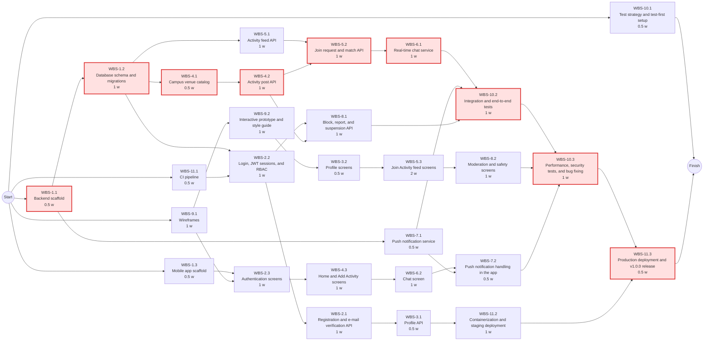
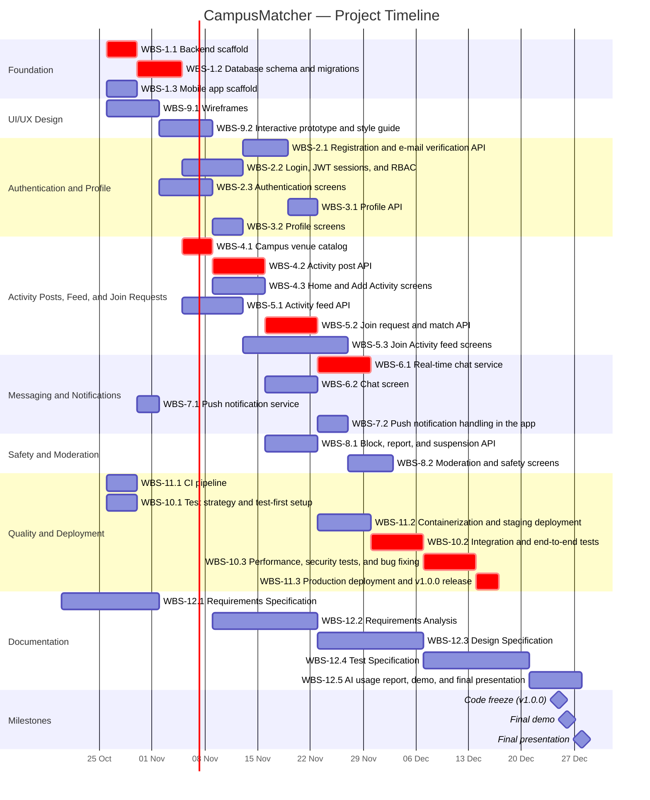

# Software Engineering — Project Plan

## Cover Page

| Field | Details |
|---|---|
| **Course** | BLG411E Software Engineering |
| **Report name** | Project Plan |
| **Project title** | CampusMatcher |
| **Group name / number** | Group B.B.F |
| **Group members** | Enes Durukan — 150230100, Erinç Özarı — [Student ID], Mohammed Alashi — 150240935, Ali Çetin — [Student ID], İbrahim Meral — 150220101 |
| **Instructor** | Prof. Dr. Tolga Ovatman, Assoc. Prof. Dr. Ayşe Tosun |
| **Submission date** | 2026-10-20 |
| **Document version** | 1.0 |

---

## 1. Introduction

### 1.1 Scope

**Project overview:**
University students often skip campus activities such as studying at the library, working out at the gym, or eating at the cafeteria because they have no one to go with. CampusMatcher is a mobile application (Android and iOS) for enrolled university students that solves this problem. The application has two main actions on its home screen. With **Add Activity**, a student publishes an activity post with an activity category, a campus venue chosen from a predefined list, and a time window (e.g., *Library, 19:00–23:00*). With **Join Activity**, a student browses a social-media-style feed of all active posts, filters it by activity and hour, opens a post to see its details, and sends the post owner a join request with a message. When the owner accepts the request, the two students are matched and agree on the exact meeting point in the chat. A matched post is removed from the feed automatically one hour after the match, and posts whose time window has ended are removed as well. The application has no swipe-based matching and no friend system; a match belongs to a single post only. System administrators moderate the platform by reviewing user reports and suspending accounts.

**In scope:**
- User registration restricted to verified university e-mail addresses, login, and token-based sessions.
- Role-based authorization for students and administrators.
- User profile management (profile information, faculty/department, interests, activity preferences).
- Home screen with the two main actions: Add Activity and Join Activity.
- Activity posts (Add Activity): creating, editing, and deleting posts with an activity category, a campus venue selected from a predefined list, a time window, and an optional short note.
- Activity feed (Join Activity): a feed of all active posts of other students with their details, filterable by activity category and hour (and venue).
- Join requests and matching: a student sends a join request with a message to the post owner; the owner accepts or declines it. An accepted request is a match. A matched post is removed from the feed automatically one hour after the match, and expired posts are removed when their time window ends.
- Text-based in-app messaging between the post owner and the requesting student; the exact meeting point is agreed in the chat.
- Push notifications for new join requests, request responses, and new messages.
- Safety and moderation: blocking and reporting users, and admin-only screens to review reports and suspend accounts.
- A service-based backend offering a REST API, hosted on a cloud platform with a relational database, with a CI/CD pipeline.

**Optional scope:**
- Group matching: a post owner sets a capacity of more than two participants, and the post stays in the feed until it is full.
- Basic usage statistics for administrators (e.g., most popular venues and time slots).

**Out of scope:**
- GPS and device location services, including real-time location tracking, live location sharing, map views, and distance-based matching.
- A friend system (friend requests, adding or removing friends, friend lists) or any other persistent social connection between users.
- Dating or romantic matching features.
- Voice and video calling.
- Integration with official university systems (student information system, campus card, facility reservation systems).
- Payment, in-app purchase, or monetization features.
- Multi-university (multi-tenant) support.
- A full-featured web client for students (the student interface is a mobile application).
- Publishing the application to the Google Play Store or Apple App Store.

**Assumptions and constraints:**
- **Team:** Five members. One man-week is defined as 40 hours. Each member is available about 20 hours per week (0.5 FTE): at most 0.4 FTE for development activities and 0.1 FTE for documentation and meetings.
- **Time:** Development runs from 2026-10-26 to 2026-12-17. The code freeze is on 2026-12-25 (release `v1.0.0` on `main`), the final demo is on 2026-12-26, and the final presentation is in the week of 2026-12-28. Document deadlines are fixed by the course schedule. The midterm exam (week of 2026-11-23) and other courses reduce availability around that time.
- **Budget:** There is no budget. Only free tiers are used: Neon PostgreSQL, a free cloud hosting tier (Render or Azure for Students), Firebase Cloud Messaging, and Expo.
- **Technology:** Python/FastAPI backend, React Native (Expo) mobile application, PostgreSQL database, JWT authentication, GitHub Actions for CI/CD.
- **Process:** All work is tracked as GitHub issues on the project board. Nobody commits directly to `main`; every change goes through a pull request with at least one approval. A test-first approach is followed.
- **AI agents:** Claude Code, GitHub Copilot, and ChatGPT are used as assistants. Every AI-generated output is reviewed by a team member in a pull request, and AI usage, effort, introduced errors, and their fixes are reported.
- **Domain:** The campus venue list is predefined and stored as seed data; no location data is collected from devices. University e-mail addresses are checked by their domain (e.g., `@itu.edu.tr`). The customer (TA) may change requirements; every request is recorded as a `customer-requests` issue within 48 hours.

### 1.2 Deliverables

| Deliverable ID | Deliverable name | Description / contents | Acceptance criterion |
|---|---|---|---|
| D-01 | CampusMatcher mobile application | React Native (Expo) application for Android and iOS with authentication, profile, home (Add Activity / Join Activity), activity feed, join request, chat, notification, and moderation screens. | All in-scope user flows can be completed on an Android and an iOS device against the deployed backend during the final demo. |
| D-02 | Backend API services | FastAPI REST API and WebSocket service for authentication, profiles, venues, activity posts, the activity feed, join requests and matches, messaging, notifications, and moderation. | All endpoints are documented (OpenAPI) and pass their unit and integration tests in CI. |
| D-03 | Database | Neon PostgreSQL schema, Alembic migrations, and venue seed data. | Migrations run on an empty database without errors, and the seed data loads successfully. |
| D-04 | CI/CD pipeline and cloud deployment | GitHub Actions workflow, Docker image, staging and production environments. | Every pull request runs lint and tests automatically; the production API is reachable, and release `v1.0.0` is published on `main` by 2026-12-25. |
| D-05 | Automated test suite | Unit, integration, end-to-end, performance, and security tests in the `tests/` folder. | All tests pass on the release; backend line coverage is at least 70%; no open critical defect remains. |
| D-06 | UI/UX design package | Wireframes, an interactive prototype, and a style guide. | Approved by the team and presented to the customer; implemented screens follow the style guide. |
| D-07 | Project documentation | Project Charter, Project Plan, Requirements Specification, Requirements Analysis, Design Specification, Test Specification, AI usage report, README, and final presentation. | Each document is released on time with the required release name, and all review comments are resolved before the next deadline. |

### 1.3 Functional Requirements / Tasks

| Task ID | Functional requirement / task | Description | Related deliverable ID(s) |
|---|---|---|---|
| T-01 | System foundation | Backend and mobile project scaffolds and the database schema that all features build on. | D-01, D-02, D-03 |
| T-02 | Registration, authentication, and authorization | Students register with a verified university e-mail address and log in; the system issues tokens and restricts endpoints by role (student, admin). | D-01, D-02, D-03 |
| T-03 | Profile management | Students view and update their profile information, faculty/department, interests, and activity preferences. | D-01, D-02 |
| T-04 | Activity posts (Add Activity) | Students publish, edit, and delete activity posts with a category, a campus venue from the predefined list, and a time window; expired posts are removed automatically. | D-01, D-02, D-03 |
| T-05 | Activity feed and join requests (Join Activity) | Students browse and filter the feed of active posts and send join requests; post owners accept or decline them. An accepted request is a match, and the matched post is removed from the feed one hour later. | D-01, D-02 |
| T-06 | In-app messaging | The post owner and the requesting student chat in real time, starting with the join request message, to agree on the exact meeting point; the chat closes when the post is removed. | D-01, D-02 |
| T-07 | Push notifications | Users receive notifications for new join requests, request responses, and new messages. | D-01, D-02 |
| T-08 | Safety and moderation | Students block and report users; administrators review reports and suspend accounts. | D-01, D-02 |
| T-09 | UI/UX design | Wireframes, prototype, and style guide for all screens. | D-06, D-01 |
| T-10 | Testing and quality assurance | Test strategy, test-first setup, integration, end-to-end, performance, and security testing. | D-05 |
| T-11 | CI/CD and deployment | Continuous integration, containerization, staging and production deployment, and the final release. | D-04 |
| T-12 | Documentation and reporting | Course documents, AI usage report, demo, and final presentation. | D-07 |

### 1.4 Non-functional Issues

| Quality attribute | Requirement / concern | How it will be assessed |
|---|---|---|
| Security | Only verified university e-mail addresses can register. Passwords are stored hashed (bcrypt); all traffic uses HTTPS; JWT access tokens expire; admin endpoints are restricted by role; users can only read chats of their own active matches. | Automated authorization tests (missing, expired, and wrong-role tokens), input validation tests, and a security checklist review in WBS-10.3. |
| Performance | API responses within 500 ms (95th percentile) with 100 concurrent users; the feed loads and applies filters within 1 second with 500 active posts; chat messages are delivered within 2 seconds. | Load tests on the staging environment (e.g., Locust) and timing assertions in integration tests (WBS-10.3). |
| Usability | A student can publish an activity post in under 30 seconds and in at most two screens, and can find a suitable post in the feed with at most two filter selections. The interface follows a consistent style guide with readable text and sufficient color contrast. | Usability test with at least five students using the prototype (WBS-9.2) and the final application (WBS-10.3). |
| Reliability | The service is available during the demo; the chat reconnects automatically after a network loss; matched and expired posts are removed on time even after a server restart. | End-to-end tests (WBS-10.2), reconnect tests, and monitoring of the staging environment. |
| Privacy | No GPS or device location is collected; only the selected campus venue is stored. Blocked users cannot see or contact the blocking user. Only necessary personal data is stored. | Data-model review in the Design Specification and moderation tests in WBS-10.2. |
| Maintainability | Every change is reviewed in a pull request; backend test coverage is at least 70%; code follows a shared lint configuration. | CI coverage report and lint checks on every pull request. |

---

## 2. Project Plan — Work Breakdown Structure (WBS)

Each task in Section 1.3 is broken down into subtasks. Sizes use the five-level scale:

**T = Tiny · S = Small · M = Medium · L = Large · XL = Extra-large**

| WBS activity ID | Parent task ID | Activity / subtask | Description / completion condition | Size (T/S/M/L/XL) |
|---|---|---|---|---|
| WBS-1.1 | T-01 | Backend scaffold | FastAPI project structure, configuration, health-check endpoint, and Pytest setup. Done when the service starts locally and the health-check test passes in CI. | S |
| WBS-1.2 | T-01 | Database schema and migrations | Tables for users, venues, activity posts, join requests, matches, messages, blocks, and reports on Neon PostgreSQL with Alembic migrations. Done when migrations run on a clean database and model tests pass. | M |
| WBS-1.3 | T-01 | Mobile app scaffold | Expo + TypeScript project, React Navigation skeleton, Axios API client, and Jest setup. Done when the app runs on Android and iOS (Expo Go) and a sample test passes. | S |
| WBS-2.1 | T-02 | Registration and e-mail verification API | Sign-up restricted to university e-mail domains, verification e-mail with a one-time code, and password hashing. Done when unverified or non-university accounts are rejected in tests. | M |
| WBS-2.2 | T-02 | Login, JWT sessions, and RBAC | Login endpoint, access/refresh tokens, and role-based authorization middleware (student, admin). Built first so that all other services can use the same authorization check. Done when protected endpoints reject missing, expired, or wrong-role tokens in tests. | M |
| WBS-2.3 | T-02 | Authentication screens | Register, verify-code, and login screens with secure token storage on the device. Done when a user can register, verify, and log in against the staging API. | M |
| WBS-3.1 | T-03 | Profile API | Endpoints to view and update profile information, faculty/department, interests, and activity preferences. Done when CRUD and validation tests pass. | S |
| WBS-3.2 | T-03 | Profile screens | Profile view and edit screens with preference selection. Done when profile changes are saved and shown again after reopening the app. | S |
| WBS-4.1 | T-04 | Campus venue catalog | Predefined list of campus venues per activity category (library, gym, cafeteria) with seed data and a read-only endpoint. Done when the app can list venues by category. | T |
| WBS-4.2 | T-04 | Activity post API | Create, edit, and delete activity posts (category, venue, time window, optional short note) with validation of past and overlapping time windows, and a scheduled job that removes expired posts. Done when all post rules and the removal job are covered by passing tests. | M |
| WBS-4.3 | T-04 | Home and Add Activity screens | Home screen with the two main actions (Add Activity, Join Activity) and the Add Activity flow: choose a category and venue, set the time window, and publish; list, edit, or delete own posts. Done when a post created in the app appears in the feed. | M |
| WBS-5.1 | T-05 | Activity feed API | Endpoint that lists active posts of other students, newest first, with filters for activity category, time (hour range), and venue, and with pagination; posts of blocked users are hidden. Done when filter and pagination tests pass. | M |
| WBS-5.2 | T-05 | Join request and match API | A student sends a join request with a message to the post owner; the owner accepts or declines it. An accepted request is a match: the post is closed and removed from the feed automatically one hour after the match. Done when every request state and the removal rule are tested. | M |
| WBS-5.3 | T-05 | Join Activity feed screens | The main feed screen (social-media-style list of posts with their details), filter controls for activity and hour, the post detail screen with the join request message, and the owner's request inbox with accept/decline. Done when a student can find a post with filters, send a request, and get accepted. | L |
| WBS-6.1 | T-06 | Real-time chat service | WebSocket chat between a post owner and a requesting student: the chat starts with the join request message, continues after the match, and closes when the post is removed. Done when messages are delivered in real time in integration tests. | L |
| WBS-6.2 | T-06 | Chat screen | Chat screen between the post owner and the requesting student, used to agree on the exact meeting point. Done when two devices exchange messages through the staging server. | M |
| WBS-7.1 | T-07 | Push notification service | Firebase Cloud Messaging integration, device-token storage, and a notification sender; join requests, request responses, and messages call this sender when they are implemented (WBS-5.2, WBS-6.1). Done when a test notification reaches a registered device. | S |
| WBS-7.2 | T-07 | Push notification handling in the app | Device token registration and opening the related screen when a notification is tapped. Done when notifications arrive on a test device. | S |
| WBS-8.1 | T-08 | Block, report, and suspension API | Blocking users (their posts are hidden from the feed and they cannot send requests or messages), reporting users or posts, and admin endpoints to review reports and suspend accounts. Done when blocked users can no longer see or contact the blocking user in tests. | M |
| WBS-8.2 | T-08 | Moderation and safety screens | Block and report actions for students, plus admin-only screens to review reports and suspend accounts. Done when an admin can suspend a reported user from the app. | M |
| WBS-9.1 | T-09 | Wireframes | Low-fidelity wireframes for all core screens and the main user flows. Done when the team reviews and approves the wireframes. | M |
| WBS-9.2 | T-09 | Interactive prototype and style guide | Clickable prototype, color/typography style guide, and reusable component list. Done when the prototype is shown to the customer and feedback is recorded. | M |
| WBS-10.1 | T-10 | Test strategy and test-first setup | Test strategy, Pytest/Jest configuration, coverage reporting, and the rule that every PR includes tests. Done when coverage is reported on every PR. | S |
| WBS-10.2 | T-10 | Integration and end-to-end tests | Tests for the main flow: register → create plan → match → chat → block/report. Done when the full flow passes against the staging environment. | M |
| WBS-10.3 | T-10 | Performance, security tests, and bug fixing | Load test of the feed and chat endpoints, security checks (authorization, input validation), and fixing found defects. Done when no open critical bug remains. | L |
| WBS-11.1 | T-11 | CI pipeline | GitHub Actions workflow running lint and tests on every pull request; branch protection on main. Done when a failing test blocks a PR. | S |
| WBS-11.2 | T-11 | Containerization and staging deployment | Docker image for the backend, deployment to the cloud platform with Neon PostgreSQL, and automatic deployment from main. Done when the staging API is reachable by the mobile app. | M |
| WBS-11.3 | T-11 | Production deployment and v1.0.0 release | Production configuration, final deployment, and the v1.0.0 release on main. Done when the release is published and the demo runs from it. | S |
| WBS-12.1 | T-12 | Requirements Specification | User stories with acceptance criteria and use cases; released as `requirements-spec-v1.0` by 2026-11-02. | M |
| WBS-12.2 | T-12 | Requirements Analysis | Data models, behavioral models, prototypes, and wireframes; released as `requirements-analysis-v1.0` by 2026-11-23. | M |
| WBS-12.3 | T-12 | Design Specification | Architecture, API, and database design; released as `design-spec-v1.0` by 2026-12-07. | M |
| WBS-12.4 | T-12 | Test Specification | Test plan and test cases; released as `test-spec-v1.0` by 2026-12-21. | M |
| WBS-12.5 | T-12 | AI usage report, demo, and final presentation | AI usage report, demo scenario from `v1.0.0`, and the final presentation by 2026-12-28. | S |

**WBS decomposition notes:**
- Every feature is split into a **backend activity** (API and business logic) and a **mobile activity** (screens). Both sides work against an API contract agreed in the Design Specification, so they can be developed in parallel.
- **T-01 (foundation)** comes first, because all features need the backend scaffold, the database schema, and the mobile scaffold.
- **The activity feed (WBS-5.1, WBS-5.3)** is the core of the product: the Join Activity feed is the main screen of the application, so its mobile part (WBS-5.3) is the largest UI activity. The feed API starts right after the schema and is developed test-first on fixture data.
- **The venue catalog (WBS-4.1)** replaces GPS: venues are a fixed list, which keeps location handling simple and supports the out-of-scope decision on location services.
- **The chat (WBS-6.1)** depends on join requests (WBS-5.2), because a chat starts with a join request message. The push notification sender (WBS-7.1) is built early, and request and message events call it once they exist.
- **Login and RBAC (WBS-2.2)** is built before registration (WBS-2.1), so that every other service can use the same authorization check early.
- **Some dependencies are resource dependencies:** when the same member owns two activities, the second one follows the first (e.g., WBS-7.1 → WBS-8.1 for İbrahim Meral, WBS-3.1 → WBS-11.2 for Ali Çetin), so that no member is overloaded.
- **Testing** is part of every activity: an activity is complete only when its unit tests pass in CI. WBS-10.x covers the cross-feature tests.
- **Documentation (WBS-12.x)** follows the fixed course deadlines and runs in parallel with development.

> **Course guideline note:** User stories for these subtasks will be written in the separate requirements document; this project plan defines and sizes the subtasks.

---

## 3. Estimates

Effort is estimated for each WBS activity in **man-weeks** (1 man-week = 40 hours).

| WBS activity ID | Size | Estimated effort (man-weeks) | Basis / assumptions |
|---|---|---|---|
| WBS-1.1 | S | 0.2 | Standard framework setup; AI-generated boilerplate reviewed by the lead. |
| WBS-1.2 | M | 0.4 | Seven related entities with constraints; first migration plus review. |
| WBS-1.3 | S | 0.2 | Template-based setup; device testing on both platforms adds some effort. |
| WBS-2.1 | M | 0.4 | Includes an external e-mail service integration and its error handling. |
| WBS-2.2 | M | 0.4 | Security-sensitive; extra review and negative test cases are included. |
| WBS-2.3 | M | 0.4 | Three screens with form validation; built against the agreed API contract. |
| WBS-3.1 | S | 0.2 | Simple CRUD on a single resource. |
| WBS-3.2 | S | 0.2 | Two screens reusing shared UI components. |
| WBS-4.1 | T | 0.1 | Static reference data; no GPS or map integration (out of scope). |
| WBS-4.2 | M | 0.4 | Several business rules on time windows plus a scheduled job; test-first development. |
| WBS-4.3 | M | 0.4 | Date/time pickers and venue selection add UI complexity. |
| WBS-5.1 | M | 0.4 | Query with several filters and indexes; developed test-first on fixture data. |
| WBS-5.2 | M | 0.4 | State machine plus a timed removal rule. |
| WBS-5.3 | L | 0.8 | The main screen of the application with filters and several states; highest UI effort. |
| WBS-6.1 | L | 0.8 | Real-time communication is new for the team; two developers in parallel. |
| WBS-6.2 | M | 0.4 | Real-time UI updates and reconnect handling. |
| WBS-7.1 | S | 0.2 | Well-documented external service; event hooks are small additions later. |
| WBS-7.2 | S | 0.2 | Platform permission handling on Android and iOS. |
| WBS-8.1 | M | 0.4 | Touches feed, request, and chat rules; they all call the shared block check. |
| WBS-8.2 | M | 0.4 | Role-dependent screens inside the same mobile application. |
| WBS-9.1 | M | 0.4 | About 12 screens; one review round with the team. |
| WBS-9.2 | M | 0.4 | Used in the Requirements Analysis (prototypes and wireframes). |
| WBS-10.1 | S | 0.2 | Tooling setup; shared by all developers afterwards. |
| WBS-10.2 | M | 0.4 | Depends on all backend features being available. |
| WBS-10.3 | L | 0.8 | Whole-team stabilization week before the code freeze. |
| WBS-11.1 | S | 0.2 | Standard workflow templates. |
| WBS-11.2 | M | 0.4 | First cloud deployment for the team; includes secret management. |
| WBS-11.3 | S | 0.2 | Repeats the staging process with final checks. |
| WBS-12.1 | M | 0.4 | Two members at 0.1 FTE for two weeks; the user story format is defined in the course. |
| WBS-12.2 | M | 0.4 | Two members at 0.1 FTE for two weeks; reuses the wireframes from WBS-9.1. |
| WBS-12.3 | M | 0.4 | Two members at 0.1 FTE for two weeks; based on the implemented scaffold and schema. |
| WBS-12.4 | M | 0.4 | Two members at 0.1 FTE for two weeks; reuses the existing automated tests. |
| WBS-12.5 | S | 0.2 | Two members at 0.1 FTE for one week. |
| **Total** | — | **12.1** | Development 10.3 + documentation 1.8 man-weeks |

**Estimation method:**
1. The team sized each activity with **planning poker** (T-shirt sizes); when estimates differed, the team discussed them and estimated again until consensus.
2. Each size was converted to man-weeks with a fixed scale:

| Size | T | S | M | L | XL |
|---|---|---|---|---|---|
| Effort (man-weeks) | 0.1 | 0.2 | 0.4 | 0.8 | 1.2 |
| Effort (hours) | 4 | 8 | 16 | 32 | 48 |

3. **AI agents:** the scale already assumes AI-assisted development. We expect Claude Code and GitHub Copilot to reduce writing time for boilerplate code and tests by about 25%, but every AI-generated output is reviewed and tested by a team member, which adds review effort. The net effect is included in the scale; AI agents are not counted as separate team members.
4. **Expert judgement:** the team leads checked the estimates in their area (backend, mobile, DevOps, QA). Activities with new technologies for the team (WebSocket chat) and the main feed screen were sized one level higher.

**Capacity check:** the total estimate is **12.1 man-weeks**. The team capacity for development is 5 members × 0.4 FTE × 8 weeks = 16 man-weeks, and for documentation 5 × 0.1 FTE × 10 weeks = 5 man-weeks. This leaves a buffer of about 35% for customer requests, bug fixing, and estimation errors.

**Effort versus duration:** If an activity requires **2 man-weeks** and **2 fully allocated team members** can work in parallel, its estimated duration is **1 week** (assuming no other constraints). In this plan, **duration = effort ÷ total FTE allocated to the activity**, rounded to half weeks. For example, WBS-5.3 needs 0.8 man-weeks and one member at 0.4 FTE, so it takes 2 weeks.

---

## 4. Resources

### 4.1 Team Structure and Member Roles

The team uses a matrix structure with three technical areas (mobile, backend, DevOps/QA), each with a lead. The Project Manager coordinates the whole team and the customer communication.

| Member | Student ID | Role(s) | Main responsibilities |
|---|---|---|---|
| Enes Durukan | 150230100 | Project Manager; Mobile Developer | Planning and tracking on the project board, customer meetings and `customer-requests` issues, delivery coordination; app screens, navigation, API integration, and push notifications on the device. |
| Erinç Özarı | [Student ID] | Mobile Team Lead; Mobile Developer & UI/UX Designer | Owner of the UI/UX design (wireframes, prototype, style guide); reusable UI components; mobile code reviews. |
| Mohammed Alashi | [Student ID] | Backend Team Lead; Backend Developer | API architecture and endpoint design, database schema, the activity feed and join request (matching) services; backend code reviews. |
| Ali Çetin | [Student ID] | DevOps Lead; Backend Developer & DevOps Engineer | Authentication and authorization (JWT, RBAC) and user/profile services; Docker, CI/CD pipeline, cloud deployment, and releases. |
| İbrahim Meral | [Student ID] | QA Lead; Backend Developer & QA Engineer | Messaging (WebSocket), notification, and moderation services, plus the venue and activity post services; test strategy, automated test suites, and test-first enforcement. |

### 4.2 Member-to-Activity Assignment

| WBS activity ID | Assigned member | Responsibility | Allocation to activity (FTE) |
|---|---|---|---|
| WBS-1.1 | Mohammed Alashi | Sets up the FastAPI project and module layout | 0.4 |
| WBS-1.2 | Mohammed Alashi | Designs the schema and writes the migrations | 0.4 |
| WBS-1.3 | Enes Durukan | Creates the Expo project, navigation, and API client | 0.4 |
| WBS-2.1 | Ali Çetin | Implements the registration and verification endpoints | 0.4 |
| WBS-2.2 | Ali Çetin | Implements token handling and authorization middleware | 0.4 |
| WBS-2.3 | Enes Durukan | Builds the authentication screens and token storage | 0.4 |
| WBS-3.1 | Ali Çetin | Implements the profile endpoints and their tests | 0.4 |
| WBS-3.2 | Erinç Özarı | Builds the profile screens using the style guide | 0.4 |
| WBS-4.1 | İbrahim Meral | Prepares venue seed data and the listing endpoint | 0.2 |
| WBS-4.2 | İbrahim Meral | Implements post endpoints, validation, and the removal job | 0.4 |
| WBS-4.3 | Enes Durukan | Builds the home screen and the Add Activity flow | 0.4 |
| WBS-5.1 | Mohammed Alashi | Designs and implements the feed query and filters | 0.4 |
| WBS-5.2 | Mohammed Alashi | Implements join requests, match states, and post closing | 0.4 |
| WBS-5.3 | Erinç Özarı | Builds the feed, filters, post detail, and request inbox | 0.4 |
| WBS-6.1 | İbrahim Meral | Implements the WebSocket service and persistence | 0.4 |
| WBS-6.1 | Mohammed Alashi | Connects chat access rules to join requests and matches | 0.4 |
| WBS-6.2 | Enes Durukan | Builds the chat screen and WebSocket client | 0.4 |
| WBS-7.1 | İbrahim Meral | Integrates FCM and builds the notification sender | 0.4 |
| WBS-7.2 | Enes Durukan | Implements notification handling on the device | 0.4 |
| WBS-8.1 | İbrahim Meral | Implements block, report, and suspension logic | 0.4 |
| WBS-8.2 | Erinç Özarı | Builds the safety actions and admin screens | 0.4 |
| WBS-9.1 | Erinç Özarı | Designs the wireframes for all screens | 0.4 |
| WBS-9.2 | Erinç Özarı | Builds the prototype and style guide | 0.4 |
| WBS-10.1 | İbrahim Meral | Defines the test strategy and coverage gates | 0.4 |
| WBS-10.2 | İbrahim Meral | Writes the integration and end-to-end tests | 0.4 |
| WBS-10.3 | İbrahim Meral | Runs security checks and tracks defects | 0.2 |
| WBS-10.3 | Mohammed Alashi | Fixes backend defects and runs load tests | 0.2 |
| WBS-10.3 | Enes Durukan | Fixes mobile defects | 0.2 |
| WBS-10.3 | Erinç Özarı | Fixes UI defects and checks usability | 0.2 |
| WBS-11.1 | Ali Çetin | Creates the CI workflow and branch rules | 0.4 |
| WBS-11.2 | Ali Çetin | Builds the Docker image and staging environment | 0.4 |
| WBS-11.3 | Ali Çetin | Deploys the final version and publishes the release | 0.4 |
| WBS-12.1 | Enes Durukan | Coordinates user stories and acceptance criteria | 0.1 |
| WBS-12.1 | İbrahim Meral | Writes test-oriented acceptance criteria | 0.1 |
| WBS-12.2 | Erinç Özarı | Adds prototypes and wireframes | 0.1 |
| WBS-12.2 | Mohammed Alashi | Writes data and behavioral models | 0.1 |
| WBS-12.3 | Mohammed Alashi | Writes the architecture and API design | 0.1 |
| WBS-12.3 | Ali Çetin | Writes the deployment design | 0.1 |
| WBS-12.4 | İbrahim Meral | Writes the test plan and test cases | 0.1 |
| WBS-12.4 | Ali Çetin | Documents CI and test environments | 0.1 |
| WBS-12.5 | Enes Durukan | Compiles the AI usage report and presentation | 0.1 |
| WBS-12.5 | Erinç Özarı | Prepares the demo scenario | 0.1 |

**Availability or allocation constraints:**
- Each member works about 20 hours per week on the project (0.5 FTE): at most 0.4 FTE on development and 0.1 FTE on documentation and meetings. The assignments above never exceed 0.4 FTE of development work for any member in any week.
- The Project Manager's coordination work (board tracking, customer meetings, issue writing) is part of the Project Manager's 0.1 FTE non-development allocation.
- The midterm exam is in the week of 2026-11-23, while the critical activities WBS-5.2 and WBS-6.1 are running (2026-11-16 to 2026-11-30). Their owners plan their study time in advance, and the buffer in Section 3 covers lower availability.
- Other courses' exams and assignments may temporarily reduce a member's availability; in that case work is moved to the member's area lead or shared through pair programming.
- AI agents are used as assistants and do not replace any member's allocation.

---

## 5. Schedule

Development week 1 starts on **2026-10-26**. Durations are given in weeks.

### 5.1 PERT Chart — Activity Sequence

**PERT notes (activity durations and dependencies):**
- Durations come from Section 3 (effort ÷ allocated FTE). Critical activities are shown in red.
- Three streams start in parallel in week 1: the **backend foundation** (WBS-1.1 → 1.2), the **mobile scaffold and design** (WBS-1.3, 9.1 → 9.2), and **CI and test setup** (WBS-11.1, 10.1).
- After the database schema (WBS-1.2), three backend streams run in parallel: **authentication** (WBS-2.2 → 2.1), **venues and activity posts** (WBS-4.1 → 4.2), and the **activity feed** (WBS-5.1). Join requests (WBS-5.2) need both posts and the feed.
- The mobile screens follow the design and the authentication screens, and they are developed against the agreed API contract.
- The integration and end-to-end tests (WBS-10.2) can only start after the chat, notification, and moderation services are complete.
- The documentation activities (WBS-12.x) are not part of this network, because their dates are fixed by the course deadlines (see the Gantt chart).

| WBS activity ID | Predecessors | Duration (weeks) | Earliest start (week) | Earliest finish (week) | Slack (weeks) |
|---|---|---|---|---|---|
| WBS-1.1 | — | 0.5 | 0 | 0.5 | 0 |
| WBS-1.2 | WBS-1.1 | 1 | 0.5 | 1.5 | 0 |
| WBS-1.3 | — | 0.5 | 0 | 0.5 | 2 |
| WBS-2.1 | WBS-2.2 | 1 | 2.5 | 3.5 | 2 |
| WBS-2.2 | WBS-1.2, WBS-11.1 | 1 | 1.5 | 2.5 | 1.5 |
| WBS-2.3 | WBS-1.3, WBS-9.1 | 1 | 1 | 2 | 1.5 |
| WBS-3.1 | WBS-2.1 | 0.5 | 3.5 | 4 | 2 |
| WBS-3.2 | WBS-9.2 | 0.5 | 2 | 2.5 | 0.5 |
| WBS-4.1 | WBS-1.2 | 0.5 | 1.5 | 2 | 0 |
| WBS-4.2 | WBS-4.1 | 1 | 2 | 3 | 0 |
| WBS-4.3 | WBS-2.3 | 1 | 2 | 3 | 1.5 |
| WBS-5.1 | WBS-1.2 | 1 | 1.5 | 2.5 | 0.5 |
| WBS-5.2 | WBS-5.1, WBS-4.2 | 1 | 3 | 4 | 0 |
| WBS-5.3 | WBS-3.2 | 2 | 2.5 | 4.5 | 0.5 |
| WBS-6.1 | WBS-5.2 | 1 | 4 | 5 | 0 |
| WBS-6.2 | WBS-4.3 | 1 | 3 | 4 | 1.5 |
| WBS-7.1 | WBS-1.1 | 0.5 | 0.5 | 1 | 4 |
| WBS-7.2 | WBS-6.2, WBS-7.1 | 0.5 | 4 | 4.5 | 1.5 |
| WBS-8.1 | WBS-2.2, WBS-4.2 | 1 | 3 | 4 | 1 |
| WBS-8.2 | WBS-5.3 | 1 | 4.5 | 5.5 | 0.5 |
| WBS-9.1 | — | 1 | 0 | 1 | 0.5 |
| WBS-9.2 | WBS-9.1 | 1 | 1 | 2 | 0.5 |
| WBS-10.1 | — | 0.5 | 0 | 0.5 | 7 |
| WBS-10.2 | WBS-6.1, WBS-7.1, WBS-8.1 | 1 | 5 | 6 | 0 |
| WBS-10.3 | WBS-10.2, WBS-8.2, WBS-7.2 | 1 | 6 | 7 | 0 |
| WBS-11.1 | — | 0.5 | 0 | 0.5 | 2.5 |
| WBS-11.2 | WBS-3.1 | 1 | 4 | 5 | 2 |
| WBS-11.3 | WBS-10.3, WBS-11.2 | 0.5 | 7 | 7.5 | 0 |

### 5.2 Critical Path and Total Project Duration

**Critical path (in activity order):**
`WBS-1.1 → WBS-1.2 → WBS-4.1 → WBS-4.2 → WBS-5.2 → WBS-6.1 → WBS-10.2 → WBS-10.3 → WBS-11.3`

| Critical-path activity ID | Duration (weeks) | Reason it is critical |
|---|---|---|
| WBS-1.1 | 0.5 | Every backend activity depends on the scaffold; it has no slack. |
| WBS-1.2 | 1 | All backend features need the database schema. |
| WBS-4.1 | 0.5 | Posts need a venue from the catalog. |
| WBS-4.2 | 1 | Join requests and the feed need activity posts. |
| WBS-5.2 | 1 | The chat starts with a join request, so it cannot start without this API. |
| WBS-6.1 | 1 | Chat is the last feature needed before integration testing can start. |
| WBS-10.2 | 1 | Needs all backend features; the final stabilization depends on its results. |
| WBS-10.3 | 1 | No release is possible while critical defects remain open. |
| WBS-11.3 | 0.5 | The final step; the code freeze deadline depends on it. |

**Total project schedule:** **10 weeks**, from **2026-10-20** to **2026-12-28**. The development network on the critical path takes **7.5 weeks**, from **2026-10-26** to **2026-12-17**.

**Critical-path explanation:**
The critical path is the longest path from Start to Finish in the PERT network; it is found by calculating the earliest start and finish of each activity (forward pass) and the latest start and finish (backward pass). The activities with zero slack form the critical path: `WBS-1.1 → WBS-1.2 → WBS-4.1 → WBS-4.2 → WBS-5.2 → WBS-6.1 → WBS-10.2 → WBS-10.3 → WBS-11.3`. Its length is 7.5 weeks, so development ends on 2026-12-17. This leaves **8 days of buffer** before the code freeze on 2026-12-25. A delay in any critical activity, especially the join request API (WBS-5.2) or the chat service (WBS-6.1), directly delays the release; these activities are therefore assigned to members who have no other activity at the same time, and their progress is checked in every weekly meeting. The total project (10 weeks) also includes the planning week before development and the demo and final presentation after the code freeze.

### 5.3 Gantt Chart — Project Timeline

**Schedule consistency check:**
- **WBS ↔ estimates:** every WBS activity in Section 2 has one estimate in Section 3, and each estimate matches its size on the conversion scale.
- **Estimates ↔ resources:** every activity's duration equals its effort divided by the FTE allocated in Section 4.2 (e.g., WBS-6.1: 0.8 man-weeks ÷ (0.4 + 0.4) FTE = 1 week).
- **Resources ↔ availability:** no member is assigned more than 0.4 FTE of development work in any week, and each member's documentation work is 0.1 FTE.
- **PERT ↔ Gantt:** the Gantt bars use the earliest start dates from the PERT calculation, and the critical activities are marked in both charts.
- **Course deadlines:** development ends on 2026-12-17, before the code freeze on 2026-12-25, and every document activity ends on its course deadline.

---

## 6. Risks

### 6.1 Risk Impact / Probability Chart

Probability and impact are scored from **1 (lowest)** to **5 (highest)**. The risk register is listed in ascending order of probability, then impact.

| Risk ID | Risk description | Probability (1–5) | Impact (1–5) | Risk score (P × I) | Affected WBS activity ID(s) |
|---|---|---|---|---|---|
| R-01 | Verification e-mails are not delivered to university addresses (blocked by spam filters or sending limits), so users cannot register. | 2 | 2 | 4 | WBS-2.1 |
| R-02 | Free-tier limits of the cloud platform or Neon (sleeping instances, connection limits) cause downtime or slow responses. | 2 | 3 | 6 | WBS-11.2, WBS-11.3 |
| R-03 | Push notifications or builds behave differently on iOS and Android (permissions, Expo limitations). | 3 | 2 | 6 | WBS-1.3, WBS-7.1, WBS-7.2 |
| R-04 | The team has limited experience with FastAPI, React Native, and WebSocket, so activities take longer than estimated. | 3 | 3 | 9 | WBS-1.1, WBS-1.3, WBS-6.1, WBS-6.2 |
| R-05 | AI-generated code introduces defects or security problems that are not noticed. | 3 | 3 | 9 | WBS-2.1, WBS-2.2, WBS-5.1, WBS-6.1, WBS-10.3 |
| R-06 | The join request flow (requests, matches, timed post removal) and the real-time chat are more complex than estimated. | 3 | 4 | 12 | WBS-5.2, WBS-5.3, WBS-6.1 |
| R-07 | The mobile application and the backend do not fit together (different API contract), which causes integration delays. | 3 | 4 | 12 | WBS-2.3, WBS-4.3, WBS-5.3, WBS-6.2, WBS-10.2 |
| R-08 | The customer changes or adds requirements during the project. | 4 | 3 | 12 | WBS-4.2, WBS-5.1, WBS-5.3, WBS-8.2 |
| R-09 | Members are less available because of the midterm exam and other courses, which delays critical activities. | 4 | 4 | 16 | WBS-5.2, WBS-6.1, WBS-10.2 |

| Impact ↓ / Probability → | 1 (Very low) | 2 (Low) | 3 (Medium) | 4 (High) | 5 (Very high) |
|---|---|---|---|---|---|
| **1 — Very low** | — | — | — | — | — |
| **2 — Low** | — | R-01 | R-03 | — | — |
| **3 — Medium** | — | R-02 | R-04, R-05 | R-08 | — |
| **4 — High** | — | — | R-06, R-07 | R-09 | — |
| **5 — Very high** | — | — | — | — | — |

### 6.2 Risk Mitigation / Aversion Plan

| Risk ID | Related WBS activity ID(s) | Mitigation / avoidance strategy | Responsible member | Contingency if risk occurs |
|---|---|---|---|---|
| R-01 | WBS-2.1 | Use a reputable transactional e-mail service; test delivery to university addresses in the first week of WBS-2.1. | Ali Çetin | Allow an admin to verify test accounts manually for the demo, and switch to another e-mail provider. |
| R-02 | WBS-11.2, WBS-11.3 | Deploy to staging early (WBS-11.2) and monitor it; keep the deployment containerized so that it can be moved to another provider. | Ali Çetin | Move the container to another free provider (e.g., Azure for Students) and keep the instance awake during the demo. |
| R-03 | WBS-1.3, WBS-7.1, WBS-7.2 | Test on both platforms from the first week; follow Expo's notification guide. | Enes Durukan | Show notifications as in-app alerts on the affected platform. |
| R-04 | WBS-1.1, WBS-1.3, WBS-6.1, WBS-6.2 | Short learning spikes in week 1, pair programming on new technologies, and code reviews by the area leads. | Mohammed Alashi | Move members from activities with slack to the delayed activity, and simplify the feature (e.g., polling instead of WebSocket). |
| R-05 | WBS-2.1, WBS-2.2, WBS-5.1, WBS-6.1, WBS-10.3 | Every AI output goes through a pull request review and must pass tests; security-sensitive code (authentication, authorization) is reviewed by two members. | İbrahim Meral | Revert the change, add a regression test, and record the error in the AI usage report. |
| R-06 | WBS-5.2, WBS-5.3, WBS-6.1 | Start the feed API right after the schema, develop the request states test-first, and agree on the request and match states before the mobile screens are built. | Mohammed Alashi | Simplify the first version (e.g., post removal by a periodic job), and use the 8-day buffer before the code freeze. |
| R-07 | WBS-2.3, WBS-4.3, WBS-5.3, WBS-6.2, WBS-10.2 | Agree on the API contract (OpenAPI) before each feature, and test the app against the staging environment as soon as it is ready (WBS-11.2). | Erinç Özarı | Fix the contract in a joint session of the mobile and backend leads; add contract tests. |
| R-08 | WBS-4.2, WBS-5.1, WBS-5.3, WBS-8.2 | Record each request as a `customer-requests` issue within 48 hours, estimate it, and plan it against the buffer. | Enes Durukan | Defer or decline the request with a written reason (scope, time) and close it as "not planned". |
| R-09 | WBS-5.2, WBS-6.1, WBS-10.2 | Plan around the midterm week, track progress weekly on the board, and keep the buffer before the code freeze. | Enes Durukan | Move work to members with slack, use pair programming, and drop optional scope items first. |
