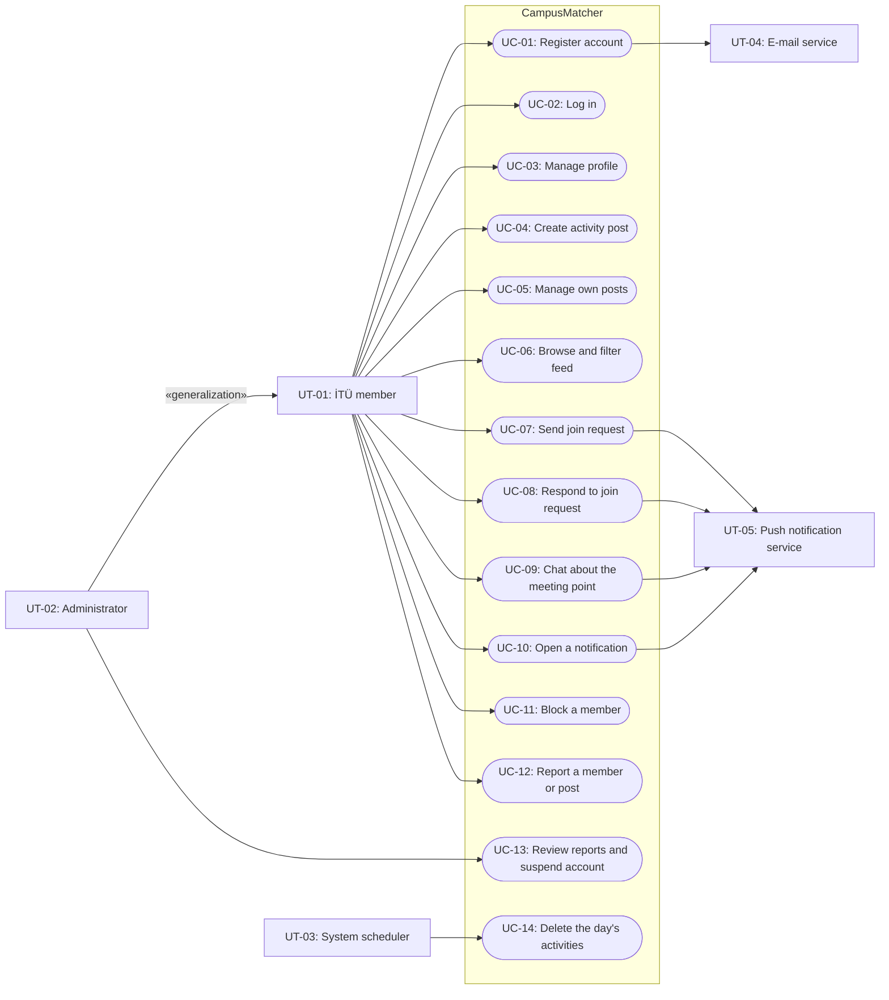
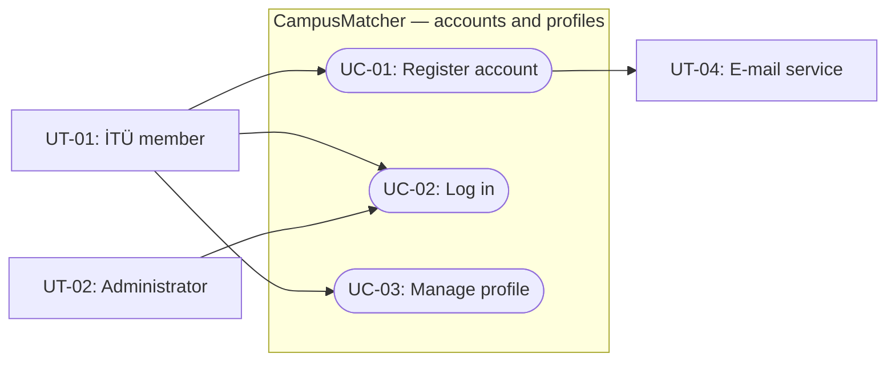
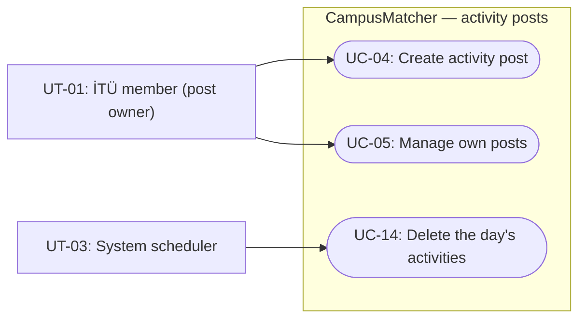
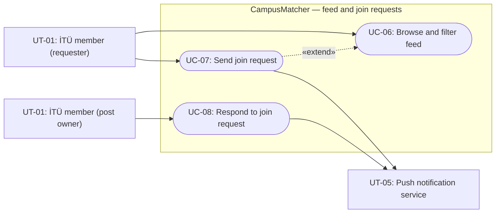
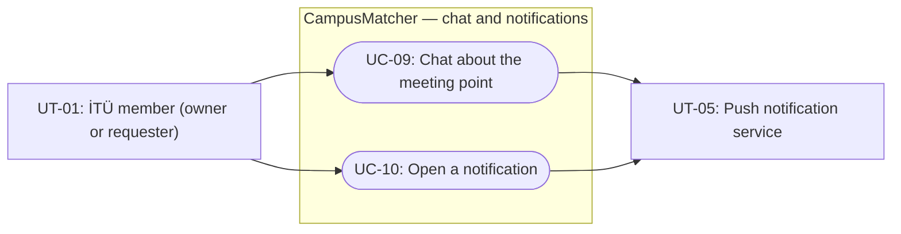
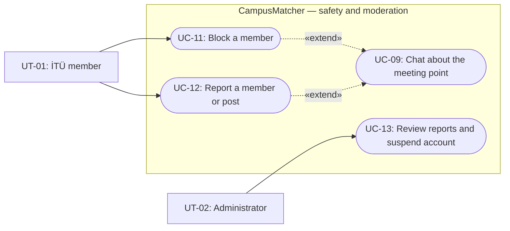

# Software Engineering — Requirements Specification

## Cover Page

| Field | Details |
|---|---|
| **Course** | BLG 411E Software Engineering |
| **Report name** | Requirements Specification |
| **Project title** | CampusMatcher |
| **Group name / number** | Group B.B.F |
| **Group members** | Enes Durukan — 150230100, Erinç Özarı — 150190060, Mohammed Alashi — 150240935, Ali Çetin — 150190741, İbrahim Meral — 150220101 |
| **Instructor** | Prof. Dr. Tolga Ovatman, Assoc. Prof. Dr. Ayşe Tosun |
| **Submission date** | 2026-11-06 |
| **Document version** | 1.0 |

---

## Changelog

### Document history

| Version | Date | Change |
|---|---|---|
| 1.0 | 2026-11-06 | First version of the Requirements Specification, based on Project Charter v1.1 and Project Plan v1.3. |

### Changes to the Project Plan since v1.0

The requirements in this document follow the latest Project Plan. The table lists every change made to the plan after its first submission (`project-plan-v1.0`) and the requirements that the change affects.

| Plan version | Date | Change | Reason / source | Affected requirements |
|---|---|---|---|---|
| 1.1 | 2026-10-29 | The application is open to all İTÜ members (students and staff) with an `@itu.edu.tr` address, not only to students. | Customer (TA) feedback | FR-01, UT-01 |
| 1.1 | 2026-10-29 | A matched post is closed and leaves the feed; it is no longer deleted one hour after the match. Instead, every day at 23:59 all activities planned for that day are deleted together with their join requests and chats. | Customer (TA) feedback on how long chats should last | FR-09, FR-15, FR-16, UC-14 |
| 1.1 | 2026-10-29 | The AI agents are reduced to two: Claude Code (coding, testing, documentation) and ChatGPT (image creation and design). | Customer (TA) feedback | — (process) |
| 1.1 | 2026-10-29 | Each mobile activity is split into a UI part built with mock data and an integration part that depends on its backend activity. The schedule is levelled so that no member works on two development activities at the same time, and staging (WBS-11.2) moves to the second week. | Customer (TA) feedback on dependencies and workload | — (schedule) |
| 1.1 | 2026-10-29 | The venue catalog (WBS-4.1) moves to Mohammed Alashi, the block/report/suspension API (WBS-8.1) moves to Ali Çetin, and all five members join WBS-10.3. | Workload balancing | — (resources) |
| 1.2 | 2026-11-02 | The member-to-activity assignment table (Section 4.2) shows each activity with its members, dates, and dependencies in one table. | Team decision | — (format) |
| 1.3 | 2026-11-05 | The test-first setup (WBS-10.1) and the style guide (WBS-9.2) become predecessors of the development activities; the API contract is defined together with the database schema in WBS-1.2; missing staging and feed dependencies are added; the documentation chain becomes part of the schedule network. | Customer (TA) review of the Project Plan | — (schedule; no requirement changes) |

---

## 1. Introduction

**Project overview:** CampusMatcher is a mobile application (Android and iOS) for the members of Istanbul Technical University (İTÜ), both students and staff. It helps them find companions for everyday campus activities such as studying at the library, working out at the gym, or eating at the cafeteria. A user either publishes an activity post (**Add Activity**) with a category, an İTÜ venue, a planned date, and a time window, or browses the feed of other users' posts (**Join Activity**) and sends the post owner a join request with a message. When the owner accepts the request, the two users are matched and agree on the exact meeting point in a chat that belongs to the activity. At the end of each day, the activities planned for that day are deleted together with their chats. Administrators keep the platform safe by reviewing reports and suspending accounts.

**Purpose of this document:** This document specifies what CampusMatcher shall do (functional requirements) and the quality constraints it shall meet (non-functional requirements), and describes how its users interact with it through user types, personas, scenarios, user stories, use case diagrams, and detailed use cases. It is written for the customer (TA), the instructors, and the development team: it is the basis for the Requirements Analysis, the Design Specification, and the acceptance tests. Every requirement is linked to a task (`T-##`), a deliverable (`D-##`), and the work-breakdown activities (`WBS-#.#`) of Project Plan v1.3.

**Writing conventions:** Following the course guidelines, every requirement has a unique ID and a source. **"shall"** marks a mandatory requirement and **"should"** a desirable one. Priorities use the MoSCoW scale: **Must** (required for the release), **Should** (important but not blocking), and **Could** (only if time allows).

**Definitions:**

| Term | Meaning |
|---|---|
| Member | A registered and verified İTÜ student or staff member. |
| Activity post | A post that announces an activity: category, venue, planned date, time window, and an optional note. |
| Open post | A post that accepts join requests and appears in the feed. |
| Closed post | A post whose owner has accepted a join request (a match). It no longer appears in the feed. |
| Join request | A request with a message that a member sends to the owner of an open post. |
| Match | An accepted join request. It belongs to one post only and does not create a lasting connection between the users. |
| Planned day | The date on which the activity takes place. The post, its requests, and its chats are deleted at 23:59 on this day. |

**Document overview:** The Changelog lists the changes to the Project Plan. Section 2 specifies the functional and non-functional requirements. Section 3 describes the user types and personas (3.1), the user scenarios and user stories with their acceptance criteria (3.2), the use case diagrams (3.3), and the detailed use cases with a coverage matrix (3.4).

---

## 2. System Requirements

### 2.1 Functional Requirements

| Requirement ID | Related task ID(s) | Related deliverable ID(s) | Functional requirement (natural language) | Priority | Source | Verification / acceptance condition |
|---|---|---|---|---|---|---|
| FR-01 | T-02 | D-01, D-02, D-03 | The system shall allow a person to register with an e-mail address in the `@itu.edu.tr` domain, a password, and a display name, and shall reject registration with any other e-mail domain. | Must | Charter; customer (TA) feedback | A registration with an `@itu.edu.tr` address is accepted; a registration with any other domain is rejected with an error message. |
| FR-02 | T-02 | D-01, D-02 | The system shall send a one-time verification code to the registration e-mail address, shall allow the person to request a new code, and shall activate the account only after the correct code is entered. | Must | Charter | An account cannot log in before verification; a wrong code is rejected; a newly requested code replaces the old one; the correct code activates the account. |
| FR-03 | T-02 | D-01, D-02 | The system shall allow a verified member to log in with an e-mail address and password, shall keep the member signed in between app launches, and shall allow the member to log out. | Must | Charter | A verified member logs in, closes and reopens the app while still signed in, and logs out. Wrong credentials are rejected. |
| FR-04 | T-02 | D-02 | The system shall allow members to use only member functions and administrators to use administrator functions as well. | Must | Charter | A member cannot open administrator functions; requests with a missing, expired, or wrong-role token are rejected. |
| FR-05 | T-03 | D-01, D-02 | The system shall allow a member to view and update their profile: display name, faculty/department, interests, and activity preferences. | Must | Charter | Profile changes are saved and shown again after the app is reopened. |
| FR-06 | T-04 | D-01, D-02, D-03 | The system shall allow a member to create an activity post with an activity category (library, gym, cafeteria), an İTÜ campus venue selected from the predefined list for that category, a planned date, a time window, and an optional short note. | Must | Charter | A post created in the app appears in the member's own post list and in the feed of other members. |
| FR-07 | T-04 | D-02 | The system shall reject a post whose time window has already passed, whose end is not after its start, or that overlaps another open post of the same member. | Must | Project Plan (WBS-4.2) | Each invalid post is rejected with a message that explains the problem. |
| FR-08 | T-04 | D-01, D-02 | The system shall allow the owner of an open post to list, edit, and delete their own posts. When an open post is deleted, its pending join requests and their chats shall be deleted with it. | Must | Charter | An edited post shows the new details in the feed; a deleted post disappears from the feed together with its pending requests and chats. |
| FR-09 | T-04 | D-02, D-03 | The system shall delete, every day at 23:59, all posts planned for that day together with their join requests and chats, and shall keep the posts planned for later days. | Must | Customer (TA) feedback | After the deletion run, no post, request, or chat of that day remains; posts for later days are unchanged. |
| FR-10 | T-05 | D-01, D-02 | The system shall show a member a feed of the open posts of other members whose time window has not ended, newest first and in pages; it shall not show the member's own posts, closed posts, or posts of blocked members. | Must | Charter | The feed contains exactly the open, unexpired posts of other unblocked members, in order. |
| FR-11 | T-05 | D-01, D-02 | The system shall allow a member to filter the feed by activity category and by hour range, and to combine the two filters. | Must | Charter | Each filter and their combination return only the matching posts. |
| FR-12 | T-05 | D-01, D-02 | The system should allow a member to filter the feed by venue, also in combination with the category and hour filters. | Should | Project Plan (WBS-5.1) | The venue filter, alone and with the other filters, returns only the posts at the selected venue. |
| FR-13 | T-05 | D-01, D-02 | The system shall allow a member to open the details of a post and send its owner a join request with a message. A member shall not be able to send a request to their own post or more than one pending request to the same post. | Must | Charter | A request is created and the owner can see it; a second request to the same post is rejected. |
| FR-14 | T-05 | D-01, D-02 | The system shall show the owner of a post the incoming join requests with their messages and the requester's profile, and shall allow the owner to accept or decline each request. | Must | Charter | The owner sees every request and its message; accept and decline change the request state. |
| FR-15 | T-05 | D-02, D-03 | When the owner accepts a join request, the system shall create a match, close the post so that it leaves the feed, and decline the other pending requests for that post. | Must | Charter; customer (TA) feedback | After an accept, the post is closed, it no longer appears in the feed, and the other requesters see their requests as declined. |
| FR-16 | T-06 | D-01, D-02 | The system shall provide a text chat between the post owner and the requester for each join request. The chat shall start with the join request message, stay open while the request is pending or matched, and become read-only when the request is declined. | Must | Charter; customer (TA) feedback | Both users can write in the chat of a pending or matched request; the chat of a declined request is read-only. |
| FR-17 | T-06 | D-01, D-02 | The system shall deliver chat messages in real time to the other user when they are online, and shall keep the messages until the activity is deleted at the end of its planned day. | Must | Charter | A message sent on one device appears on the other device without a refresh. |
| FR-18 | T-07 | D-01, D-02 | The system shall send a push notification to the post owner when a new join request arrives, to the requester when their request is accepted or declined, and to the recipient of a new chat message. | Must | Charter | Each of the three events produces a notification on a registered test device. |
| FR-19 | T-07 | D-01 | When the member taps a notification, the app should open the related screen (request inbox, request result, or chat). | Should | Project Plan (WBS-7.2) | Tapping each notification type opens the related screen. |
| FR-20 | T-08 | D-01, D-02 | The system shall allow a member to block another member. After blocking, neither member sees the other's posts, and they cannot send join requests or messages to each other. | Must | Charter | After a block, the blocked member's posts are hidden from the feed and their requests and messages are rejected, and the reverse. |
| FR-21 | T-08 | D-01, D-02 | The system shall allow a member to report another member or a post, with a reason selected from a list and an optional description. | Must | Charter | A submitted report appears in the administrator's report list. |
| FR-22 | T-08 | D-01, D-02 | The system shall allow an administrator to list the open reports, review their details, and either suspend the reported account or dismiss the report. | Must | Charter | An administrator suspends a reported member from the app, and the report is marked as handled. |
| FR-23 | T-08 | D-02 | The system shall sign out a suspended member, prevent them from logging in, and hide their open posts from the feed. | Must | Charter | A suspended member cannot log in, and their posts no longer appear in the feed. |

**Functional requirement notes:**
- **One match per post:** a post leads to at most one match, so accepting one request declines the others (FR-15). The optional group matching in the Project Plan would change this rule and is therefore not specified here.
- **Feed visibility (FR-10):** a post whose time window has ended stays in the database until the end of its planned day (FR-09), but it no longer appears in the feed, because nobody can join it any more.
- **Time zone:** all dates, time windows, and the 23:59 deletion run (FR-09) use Istanbul time (Europe/Istanbul).
- **No location data:** a venue is always selected from the predefined İTÜ list (FR-06); the exact meeting point is agreed in the chat (FR-16).
- **Rationale for the end-of-day deletion (FR-09):** the customer asked how long chats should exist. Deleting each activity and its chats at the end of its planned day keeps no history of where members have been, and posts for later days are not affected.
- **Out of scope:** GPS and location services, swipe-based or automatic matching, a friend system, activity or chat history, dating features, voice and video calls, integration with official university systems, payments, multi-university support, a web client, and store publishing (Project Charter v1.1).
- **Optional scope:** group matching and basic usage statistics for administrators are in the optional scope of the Project Plan. They will be specified in a later version of this document only if the team schedules them.

### 2.2 Non-functional Requirements

| Requirement ID | Quality attribute | Non-functional requirement (natural language) | Applies to | Verification / measurement |
|---|---|---|---|---|
| NFR-01 | Security | The system shall store passwords only as salted hashes (bcrypt) and never in plain text. | FR-01, FR-03 | Code review and a database check that no password is stored in plain text. |
| NFR-02 | Security | All communication between the app and the server, including the chat, shall be encrypted (HTTPS and secure WebSocket). | Whole system | Check of the staging and production configuration; plain HTTP requests are refused or redirected. |
| NFR-03 | Security | Access tokens shall expire, and every protected function shall reject a missing, expired, or wrong-role token. | FR-03, FR-04 | Automated authorization tests for missing, expired, and wrong-role tokens (WBS-2.2, WBS-10.3). |
| NFR-04 | Security / privacy | A member shall be able to read only the chats of the join requests they take part in, and only an administrator shall see reports. | FR-16, FR-17, FR-22 | Authorization tests with a third member and with a non-admin member. |
| NFR-05 | Performance | The API shall respond within 500 ms for 95% of requests with 100 concurrent users. | Whole system | Load test on the staging environment (WBS-10.3). |
| NFR-06 | Performance | The feed shall load and apply filters within 1 second with 500 open posts. | FR-10, FR-11, FR-12 | Load test with 500 fixture posts and timing assertions in integration tests. |
| NFR-07 | Performance | A chat message shall be delivered to an online recipient within 2 seconds. | FR-17 | Timing assertion in the chat integration tests. |
| NFR-08 | Usability | A member shall be able to publish an activity post in under 30 seconds and in at most two screens, and to find a suitable post in the feed with at most two filter selections. | FR-06, FR-11 | Usability test with at least five İTÜ members using the prototype (WBS-9.2) and the final application (WBS-10.3). |
| NFR-09 | Usability | All screens shall follow one style guide with readable text and sufficient color contrast, and every error message shall explain what went wrong and how to fix it. | Whole mobile app | Review of the screens against the style guide (WBS-9.2) and the usability principles of the course. |
| NFR-10 | Reliability | After a temporary loss of the network connection, the chat shall reconnect automatically when the network returns, without any user action, and the messages written while offline shall then be delivered without loss. | FR-17 | Reconnect test: the network is switched off, two messages are written, and the network is switched on; the test passes when both messages reach the other device without a restart. |
| NFR-11 | Reliability | The end-of-day deletion shall also run after a server restart: a missed run shall be executed when the server starts again. | FR-09 | Integration test that stops the server over 23:59 and checks the deletion after the restart. |
| NFR-12 | Privacy | The system shall not collect GPS or device location data, shall store only the personal data needed for its functions, and shall keep no activity or chat history after the planned day. | Whole system | Data-model review in the Design Specification and the deletion tests of FR-09. |
| NFR-13 | Portability | The mobile application shall run on Android and iOS from one code base. | Whole mobile app | Every release is tested on one Android and one iOS device in Expo Go. |
| NFR-14 | Maintainability | Every change shall be reviewed in a pull request, backend test coverage shall be at least 70%, and the code shall follow a shared lint configuration. | Whole system | CI coverage report and lint checks on every pull request (WBS-11.1). |

**Non-functional requirement notes / assumptions:**
- The thresholds in NFR-05 to NFR-08 are the ones agreed in Project Plan Section 1.4; they are measured on the staging environment, not on developers' computers.
- "Concurrent users" means users who send requests at the same time during the load test.
- The service is expected to be available during the final demo; this is checked by monitoring the production environment on the demo day (Project Plan R-02) rather than stated as a requirement, because the team has not agreed on an availability target.
- The application runs on recent Android and iOS versions supported by Expo Go; older devices are not tested.
- The system uses free tiers of external services (cloud hosting, Neon PostgreSQL, Firebase Cloud Messaging, an e-mail service); their limits are a project risk (Project Plan R-01, R-02) rather than a requirement.

---

## 3. Use Cases

### 3.1 User Types

| User type ID | User type / actor | Description and responsibilities | Goals / typical actions | Related requirement ID(s) |
|---|---|---|---|---|
| UT-01 | İTÜ member | A student or staff member of İTÜ with a verified `@itu.edu.tr` address. In each activity, a member acts either as the **post owner** or as the **requester**. | Register, manage the profile, publish and manage posts, browse and filter the feed, send and answer join requests, chat, block and report other members. | FR-01 to FR-21 |
| UT-02 | Administrator | A member with the administrator role who keeps the platform safe. | Review reports, suspend accounts, dismiss unfounded reports. | FR-04, FR-22, FR-23 |
| UT-03 | System scheduler | An automated, secondary actor: a scheduled job on the server. | Delete the activities of the day, with their requests and chats, every day at 23:59. | FR-09 |
| UT-04 | E-mail service | An external system that delivers e-mails. | Deliver the one-time verification code to the registration address. | FR-02 |
| UT-05 | Push notification service | An external system (Firebase Cloud Messaging) that delivers notifications to devices. | Deliver notifications about join requests, request results, and messages. | FR-18, FR-19 |

**Access or role distinctions:**
- A person without an account can only register and verify an e-mail address (FR-01, FR-02).
- Students and staff have the same rights; both are members (UT-01).
- An administrator can do everything a member can, and can also review reports and suspend accounts (FR-04, FR-22).
- A suspended member cannot log in (FR-23). A blocked member can still use the app, but not with the member who blocked them (FR-20).

**Personas:**

| Persona ID | Persona | User type | Background and needs |
|---|---|---|---|
| P-01 | Zeynep Kaya | UT-01 (student) | A third-year Computer Engineering student. She studies at the Mustafa İnan Library in the evenings and concentrates better with a study partner, but her friends have different schedules. She wants to find someone who will be at the library at the same time. |
| P-02 | Mert Demir | UT-01 (staff) | A research assistant in the Civil Engineering faculty who is preparing for his doctoral qualifying exam. He works long hours on campus and wants company for studying or a lunch break, but does not want to share his location or build a social network. |
| P-03 | Elif Aydın | UT-02 | A platform administrator. She checks the reports every day and wants to see quickly who was reported, why, and what happened, so that she can decide fairly. |

### 3.2 User Scenarios

**SC-01 — Joining CampusMatcher**
**Persona:** P-01 — Zeynep Kaya
**Related requirements:** FR-01, FR-02, FR-03, FR-05

Zeynep hears about CampusMatcher from a classmate and installs the app. She first tries her personal Gmail address, and the app tells her that only `@itu.edu.tr` addresses can register. She enters her İTÜ address, a password, and her name, and receives a six-digit code by e-mail. After she types the code, her account is active and she is logged in. She opens her profile, adds her department, and selects "library" and "algorithms" as her interests. The next day she opens the app and is still signed in.

**SC-02 — Publishing a library study session**
**Persona:** P-01 — Zeynep Kaya
**Related requirements:** FR-06, FR-07, FR-08

On Thursday afternoon, Zeynep decides to study at the library in the evening. On the home screen she taps **Add Activity**, chooses the "Library" category, selects "Mustafa İnan Library" from the venue list, keeps today's date, sets the time window to 19:00–23:00, and adds the note "Studying for the algorithms midterm". By mistake she first sets the end time to 18:00, and the app explains that the end must be after the start. She corrects it and publishes the post, which now appears in her own post list.

**SC-03 — Finding a study partner in the feed**
**Persona:** P-02 — Mert Demir
**Related requirements:** FR-10, FR-11, FR-12, FR-13, FR-18

Mert wants to study after 19:00. He taps **Join Activity**, filters the feed by "Library" and "after 18:00", and sees Zeynep's post at the top. He opens it, reads the note, and sends a join request with the message "I am studying for an exam too, can I join you?". The app shows that his request is waiting for an answer. Zeynep's phone shows a notification about a new join request.

**SC-04 — Accepting a request and agreeing on the meeting point**
**Personas:** P-01 — Zeynep Kaya, P-02 — Mert Demir
**Related requirements:** FR-14, FR-15, FR-16, FR-17, FR-18, FR-19

Zeynep taps the notification, and the app opens her request inbox. She sees Mert's request, his message, and his profile, and accepts it. Her post is now closed and disappears from the feed, and another student who had also sent a request is informed that the request was declined. Mert receives a notification that his request was accepted. In the chat, which starts with Mert's original message, Zeynep writes "Second floor, near the entrance, at 19:00", and Mert answers immediately.

**SC-05 — The end of the planned day**
**Persona:** P-01 — Zeynep Kaya
**Related requirements:** FR-09

Before leaving the library, Zeynep also publishes a post for next Tuesday. At 23:59, the system deletes Thursday's library post, Mert's request, and their chat. The next morning, Zeynep's list shows only the post for Tuesday, and no trace of Thursday's activity remains.

**SC-06 — Handling unwanted messages**
**Personas:** P-01 — Zeynep Kaya, P-03 — Elif Aydın
**Related requirements:** FR-20, FR-21, FR-22, FR-23

A member sends Zeynep a join request with a rude message. Zeynep opens the member's profile, reports them with the reason "Harassment", and blocks them. From now on, she does not see that member's posts, and the member cannot contact her. The next morning, Elif sees the report in the administrator panel together with the reported message, decides that it breaks the rules, and suspends the account. The suspended member is signed out and cannot log in again.

#### User Stories Linked to the Project Plan

Each user-facing WBS activity of Project Plan v1.3 is linked to a user story. A feature usually has a backend activity, a mobile UI activity (a), and a mobile integration activity (b); all of them implement the same user story. Technical activities without a user of their own are explained in the table.

| Scenario ID | Project Plan WBS activity ID | User story | Related requirement ID(s) |
|---|---|---|---|
| — | WBS-1.1, WBS-1.2, WBS-1.3 | Technical foundation (backend and mobile scaffolds, database schema, API contract); no user story. They support every story below. | NFR-13, NFR-14 |
| SC-01 | WBS-2.1, WBS-2.3a, WBS-2.3b | **US-01:** As an İTÜ member, I want to register with my İTÜ e-mail address so that only verified İTÜ members can use the platform. | FR-01, FR-02 |
| SC-01 | WBS-2.2, WBS-2.3a, WBS-2.3b | **US-02:** As a member, I want to log in and stay signed in so that I can use the app without entering my password every time. | FR-03, FR-04 |
| SC-01 | WBS-3.1, WBS-3.2a, WBS-3.2b | **US-03:** As a member, I want to keep my profile up to date so that other members know who they are meeting. | FR-05 |
| SC-02 | WBS-4.1, WBS-4.2, WBS-4.3a, WBS-4.3b | **US-04:** As a member, I want to publish an activity with a venue and a time window so that others who will be there at the same time can join me. | FR-06, FR-07 |
| SC-02 | WBS-4.2, WBS-4.3b | **US-05:** As a post owner, I want to edit or delete my open posts so that my plans in the app stay correct. | FR-08 |
| SC-05 | WBS-4.2 | **US-06:** As a member, I want the activities of a day and their chats to be deleted at the end of that day so that no history of where I have been is kept. | FR-09 |
| SC-03 | WBS-5.1, WBS-5.3a, WBS-5.3b | **US-07:** As a member, I want to browse and filter the feed by activity and hour so that I can quickly find an activity that fits my plan. | FR-10, FR-11, FR-12 |
| SC-03 | WBS-5.2, WBS-5.3a, WBS-5.3b | **US-08:** As a member, I want to send a join request with a message so that the post owner knows why I want to join. | FR-13 |
| SC-04 | WBS-5.2, WBS-5.3a, WBS-5.3b | **US-09:** As a post owner, I want to accept or decline join requests so that I decide who joins my activity. | FR-14, FR-15 |
| SC-04 | WBS-6.1, WBS-6.2a, WBS-6.2b | **US-10:** As a matched member, I want to chat with the other member so that we can agree on the exact meeting point. | FR-16, FR-17 |
| SC-03, SC-04 | WBS-7.1, WBS-7.2 | **US-11:** As a member, I want to receive notifications about requests and messages so that I can answer in time. | FR-18, FR-19 |
| SC-06 | WBS-8.1, WBS-8.2a, WBS-8.2b | **US-12:** As a member, I want to block another member so that they can no longer see my posts or contact me. | FR-20 |
| SC-06 | WBS-8.1, WBS-8.2a, WBS-8.2b | **US-13:** As a member, I want to report a member or a post so that administrators can act against misuse. | FR-21 |
| SC-06 | WBS-8.1, WBS-8.2a, WBS-8.2b | **US-14:** As an administrator, I want to review reports and suspend accounts so that the platform stays safe. | FR-22, FR-23 |
| — | WBS-9.1, WBS-9.2 | UI/UX design (wireframes, prototype, style guide); no user story of its own. It defines the screens of US-01 to US-14 and is checked by NFR-08 and NFR-09. | NFR-08, NFR-09 |
| — | WBS-10.1, WBS-10.2a, WBS-10.2b, WBS-10.3 | Testing activities; no user story. WBS-10.2a turns the acceptance criteria below into end-to-end tests. | NFR-03, NFR-05 to NFR-07, NFR-11 |
| — | WBS-11.1, WBS-11.2, WBS-11.3 | CI/CD and deployment; no user story. | NFR-02, NFR-10, NFR-14 |
| — | WBS-12.1 to WBS-12.5 | Documentation and reporting; no user story. | — |

#### User Story Details and Acceptance Criteria

The stories follow the user story template of the course (title, priority, story, notes, constraints, estimate). The acceptance criteria use the **Gherkin** format (Given / When / Then), so that they can be turned directly into automated tests (WBS-10.2a). Estimates are the sizes of the related WBS activities in the Project Plan.

**US-01 — Register with an İTÜ e-mail address**
- **Priority:** Must · **Estimate:** WBS-2.1 (M), WBS-2.3a (S), WBS-2.3b (S)
- **Story:** As an İTÜ member, I want to register with my İTÜ e-mail address so that only verified İTÜ members can use the platform.
- **Constraints:** Only the `@itu.edu.tr` domain is accepted; students and staff use the same domain.

```gherkin
Scenario: Register with an İTÜ address
  Given a person without an account is on the registration screen
  When they register with "zeynep@itu.edu.tr", a password, and a display name
  And they enter the verification code sent to that address
  Then the account shall be activated
  And the person shall be logged in

Scenario: Reject a non-İTÜ address
  Given a person without an account is on the registration screen
  When they register with "zeynep@gmail.com"
  Then the registration shall be rejected
  And the app shall explain that only @itu.edu.tr addresses can register
```

**US-02 — Log in and stay signed in**
- **Priority:** Must · **Estimate:** WBS-2.2 (M), WBS-2.3a (S), WBS-2.3b (S)
- **Story:** As a member, I want to log in and stay signed in so that I can use the app without entering my password every time.

```gherkin
Scenario: Stay signed in after reopening the app
  Given a verified member has logged in
  When the member closes and reopens the app
  Then the member shall still be signed in

Scenario: Reject a wrong password
  Given a verified member is on the login screen
  When the member enters a wrong password
  Then the login shall be rejected with an error message
```

**US-03 — Keep the profile up to date**
- **Priority:** Must · **Estimate:** WBS-3.1 (S), WBS-3.2a (T), WBS-3.2b (T)
- **Story:** As a member, I want to keep my profile up to date so that other members know who they are meeting.

```gherkin
Scenario: Update the profile
  Given a member is on the profile screen
  When the member changes the department and the interests and saves
  Then the new values shall be shown after the app is reopened
```

**US-04 — Publish an activity**
- **Priority:** Must · **Estimate:** WBS-4.1 (T), WBS-4.2 (M), WBS-4.3a (S), WBS-4.3b (S)
- **Story:** As a member, I want to publish an activity with a venue and a time window so that others who will be there at the same time can join me.
- **Constraints:** The venue is selected from the predefined İTÜ list; no location data is used.

```gherkin
Scenario: Publish a library activity
  Given a member is on the Add Activity screen
  When the member selects "Library", "Mustafa İnan Library", today, and "19:00–23:00", and publishes
  Then the post shall appear in the member's own post list
  And the post shall appear in the feed of other members

Scenario: Reject an invalid time window
  Given a member is on the Add Activity screen
  When the member sets the time window "19:00–18:00"
  Then the post shall not be published
  And the app shall explain that the end time must be after the start time
```

**US-05 — Edit or delete own posts**
- **Priority:** Must · **Estimate:** part of WBS-4.2 (M) and WBS-4.3b (S)
- **Story:** As a post owner, I want to edit or delete my open posts so that my plans in the app stay correct.

```gherkin
Scenario: Delete an open post
  Given a member has an open post
  When the member deletes the post
  Then the post shall no longer appear in the feed
```

**US-06 — Delete the activities of the day**
- **Priority:** Must · **Estimate:** part of WBS-4.2 (M)
- **Story:** As a member, I want the activities of a day and their chats to be deleted at the end of that day so that no history of where I have been is kept.

```gherkin
Scenario: Delete today's activities and keep later ones
  Given a post planned for today with a join request and a chat
  And a post planned for next Tuesday
  When the deletion runs at 23:59 today
  Then today's post, its join request, and its chat shall be deleted
  And the post for next Tuesday shall be kept
```

**US-07 — Browse and filter the feed**
- **Priority:** Must (venue filter, FR-12: Should) · **Estimate:** WBS-5.1 (M), WBS-5.3a (M), WBS-5.3b (M)
- **Story:** As a member, I want to browse and filter the feed by activity and hour so that I can quickly find an activity that fits my plan.

```gherkin
Scenario: Filter the feed by category and hour
  Given open posts for "Library 19:00–23:00" and "Gym 07:00–08:00"
  When a member filters the feed by "Library" and "after 18:00"
  Then only the library post shall be shown

Scenario: Hide posts of a blocked member
  Given a member has blocked another member who has an open post
  When the member opens the feed
  Then the blocked member's post shall not be shown
```

**US-08 — Send a join request**
- **Priority:** Must · **Estimate:** WBS-5.2 (M), WBS-5.3a (M), WBS-5.3b (M)
- **Story:** As a member, I want to send a join request with a message so that the post owner knows why I want to join.

```gherkin
Scenario: Send a join request
  Given a member is viewing an open post of another member
  When the member sends a join request with the message "Can I join you?"
  Then the request shall be shown to the post owner as pending
  And the post owner shall receive a notification

Scenario: Prevent a second request to the same post
  Given a member already has a pending request for a post
  When the member tries to send another request to the same post
  Then the second request shall be rejected
```

**US-09 — Accept or decline join requests**
- **Priority:** Must · **Estimate:** WBS-5.2 (M), WBS-5.3a (M), WBS-5.3b (M)
- **Story:** As a post owner, I want to accept or decline join requests so that I decide who joins my activity.

```gherkin
Scenario: Accept a request
  Given a post owner has two pending requests for an open post
  When the owner accepts the first request
  Then a match shall be created
  And the post shall be closed and removed from the feed
  And the second request shall be declined
  And both requesters shall receive a notification
```

**US-10 — Chat about the meeting point**
- **Priority:** Must · **Estimate:** WBS-6.1 (L), WBS-6.2a (S), WBS-6.2b (S)
- **Story:** As a matched member, I want to chat with the other member so that we can agree on the exact meeting point.

```gherkin
Scenario: Exchange messages in real time
  Given two members have a matched join request
  When one member sends "Second floor, near the entrance"
  Then the other member shall see the message within 2 seconds

Scenario: Read-only chat after a decline
  Given a join request was declined
  When the requester opens the chat of that request
  Then the chat shall be read-only
```

**US-11 — Receive notifications**
- **Priority:** Must (opening the related screen: Should) · **Estimate:** WBS-7.1 (S), WBS-7.2 (S)
- **Story:** As a member, I want to receive notifications about requests and messages so that I can answer in time.

```gherkin
Scenario: Open the inbox from a notification
  Given a post owner received a notification about a new join request
  When the owner taps the notification
  Then the app shall open the owner's request inbox
```

**US-12 — Block a member**
- **Priority:** Must · **Estimate:** WBS-8.1 (M), WBS-8.2a (S), WBS-8.2b (S)
- **Story:** As a member, I want to block another member so that they can no longer see my posts or contact me.

```gherkin
Scenario: A blocked member cannot send a request
  Given Zeynep has blocked another member
  When that member tries to send a join request to Zeynep's post
  Then the request shall be rejected
  And the member shall not see Zeynep's posts in the feed
```

**US-13 — Report a member or a post**
- **Priority:** Must · **Estimate:** WBS-8.1 (M), WBS-8.2a (S), WBS-8.2b (S)
- **Story:** As a member, I want to report a member or a post so that administrators can act against misuse.

```gherkin
Scenario: Report a member
  Given a member is viewing another member's profile
  When the member reports them with the reason "Harassment"
  Then the report shall appear in the administrator's report list
```

**US-14 — Review reports and suspend accounts**
- **Priority:** Must · **Estimate:** WBS-8.1 (M), WBS-8.2a (S), WBS-8.2b (S)
- **Story:** As an administrator, I want to review reports and suspend accounts so that the platform stays safe.

```gherkin
Scenario: Suspend a reported member
  Given an administrator is viewing an open report about a member
  When the administrator suspends the reported member
  Then the member shall be signed out and shall not be able to log in
  And the member's open posts shall be hidden from the feed
  And the report shall be marked as handled

Scenario: A member cannot open the report list
  Given a member without the administrator role is logged in
  When the member tries to open the report list
  Then the access shall be refused
```

### 3.3 Use Case Diagrams

The diagrams show the actors of Section 3.1, the system boundary, and the use cases of Section 3.4. A solid arrow connects an actor to a use case it takes part in. A dashed arrow labeled «extend» shows an optional use case that can start from another one.

#### 3.3.1 Whole-System Use Case Diagram



**Whole-system diagram notes:** The İTÜ member (UT-01) takes part in UC-01 to UC-12; in a single activity, the same member is either the post owner (UC-04, UC-05, UC-08) or the requester (UC-06, UC-07). The administrator (UT-02) is a specialization of the member (the «generalization» arrow): an administrator can do everything a member can, so the links of the member also apply to the administrator, and only UC-13 is reserved for administrators. The system scheduler (UT-03) starts UC-14 without a human. The e-mail service (UT-04) is used by UC-01; the push notification service (UT-05) delivers the notifications of UC-07, UC-08, and UC-09 and is the starting point of UC-10. Every task of the Project Plan with user-facing functionality (T-02 to T-08) is represented; the coverage matrix in Section 3.4.1 shows the mapping.

#### 3.3.2 Functionality-Specific Use Case Diagram — Accounts and Profiles



**Functionality covered:** T-02, T-03 / FR-01 to FR-05 / UC-01 to UC-03
**Diagram notes:** Registration needs the e-mail service to deliver the verification code. Administrators log in through the same use case as members; their role decides which functions they can use (FR-04).

#### 3.3.3 Functionality-Specific Use Case Diagram — Activity Posts



**Functionality covered:** T-04 / FR-06 to FR-09 / UC-04, UC-05, UC-14
**Diagram notes:** The post owner creates and manages posts. The end-of-day deletion is started by the system scheduler, not by a user.

#### 3.3.4 Functionality-Specific Use Case Diagram — Feed, Join Requests, and Matching



**Functionality covered:** T-05 / FR-10 to FR-15 / UC-06 to UC-08
**Diagram notes:** Sending a join request (UC-07) is an optional continuation of browsing the feed (UC-06): the requester opens a post from the feed and may send a request. Both sending and answering a request cause a notification through the push notification service.

#### 3.3.5 Functionality-Specific Use Case Diagram — Chat and Notifications



**Functionality covered:** T-06, T-07 / FR-16 to FR-19 / UC-09, UC-10
**Diagram notes:** Both users of a join request take part in its chat. A new message causes a notification; opening a notification leads back to the chat or to the request screens.

#### 3.3.6 Functionality-Specific Use Case Diagram — Safety and Moderation



**Functionality covered:** T-08 / FR-20 to FR-23 / UC-11 to UC-13
**Diagram notes:** A member can block or report from a profile or a post, and also directly from a chat, which is why UC-11 and UC-12 extend UC-09. Reports are handled only by administrators (UC-13).

### 3.4 Use Cases

#### 3.4.1 Use Case Coverage Matrix

| Project Plan task ID | Functional requirement ID(s) | Use case ID(s) | Scenario ID(s) |
|---|---|---|---|
| T-01 System foundation | — (technical; supports all FRs, see NFR-13, NFR-14) | — | — |
| T-02 Registration, authentication, and authorization | FR-01, FR-02, FR-03, FR-04 | UC-01, UC-02 | SC-01 |
| T-03 Profile management | FR-05 | UC-03 | SC-01 |
| T-04 Activity posts (Add Activity) | FR-06, FR-07, FR-08, FR-09 | UC-04, UC-05, UC-14 | SC-02, SC-05 |
| T-05 Activity feed and join requests (Join Activity) | FR-10, FR-11, FR-12, FR-13, FR-14, FR-15 | UC-06, UC-07, UC-08 | SC-03, SC-04 |
| T-06 In-app messaging | FR-16, FR-17 | UC-09 | SC-04 |
| T-07 Push notifications | FR-18, FR-19 | UC-07, UC-08, UC-09, UC-10 | SC-03, SC-04 |
| T-08 Safety and moderation | FR-20, FR-21, FR-22, FR-23 | UC-11, UC-12, UC-13 | SC-06 |
| T-09 UI/UX design | — (covered by NFR-08, NFR-09) | All use cases (screens) | — |
| T-10 Testing and quality assurance | — (covered by NFR-03, NFR-05 to NFR-07, NFR-11, NFR-14) | All use cases (acceptance tests) | — |
| T-11 CI/CD and deployment | — (covered by NFR-02, NFR-10, NFR-14) | — | — |
| T-12 Documentation and reporting | — | — | — |

T-01 and T-09 to T-12 are technical or process tasks without a user goal of their own, so they are covered by non-functional requirements instead of use cases. Every functional requirement appears in at least one use case.

#### 3.4.2 UC-01 — Register Account

| Field | Description |
|---|---|
| **Use case ID** | UC-01 |
| **Use case name** | Register account |
| **Goal / Purpose** | A person creates a verified CampusMatcher account with their İTÜ e-mail address. |
| **Actor(s)** | UT-01 — İTÜ member (not yet registered); UT-04 — E-mail service |
| **Related Project Plan task(s)** | T-02 |
| **Related functional requirement(s)** | FR-01, FR-02 |

**Pre-condition(s):** The person has the app installed and no account for this e-mail address.

**Main success flow:**
1. **Actor:** Opens the registration screen.
2. **System:** Asks for an e-mail address, a password, and a display name.
3. **Actor:** Enters an `@itu.edu.tr` address, a password, and a display name.
4. **System:** Checks the domain and creates an unverified account.
5. **System:** Sends a one-time verification code to the address through the e-mail service and asks for the code.
6. **Actor:** Enters the code.
7. **System:** Verifies the code, activates the account, and logs the member in.

**Alternative flows:**
- **A1 — The e-mail domain is not `@itu.edu.tr` (branches from step 4):**
  1. The system rejects the address and explains that only İTÜ addresses can register.
  2. The flow returns to step 3.
- **A2 — The address is already registered (branches from step 4):**
  1. The system informs the person that an account exists and offers the login screen.
  2. The use case ends without a new account.
- **A3 — The code is wrong (branches from step 7):**
  1. The system rejects the code and lets the person enter it again or request a new code.
  2. The flow returns to step 6.

**Exception / error flows:**
- **E1 — The e-mail service is unavailable (occurs at step 5):** The system keeps the unverified account, informs the person that the code could not be sent, and lets them request it again later.

**Post-condition(s):** A verified account exists for the address, and the member is logged in.

#### 3.4.3 UC-02 — Log In

| Field | Description |
|---|---|
| **Use case ID** | UC-02 |
| **Use case name** | Log in |
| **Goal / Purpose** | A member or administrator signs in to use the functions of their role. |
| **Actor(s)** | UT-01 — İTÜ member; UT-02 — Administrator |
| **Related Project Plan task(s)** | T-02 |
| **Related functional requirement(s)** | FR-03, FR-04, FR-23 |

**Pre-condition(s):** The account exists and is verified.

**Main success flow:**
1. **Actor:** Opens the login screen and enters the e-mail address and password.
2. **System:** Checks the credentials and the account status.
3. **System:** Signs the user in, keeps them signed in on the device, and opens the home screen with the functions of their role.

**Alternative flows:**
- **A1 — Wrong credentials (branches from step 2):**
  1. The system shows an error message without telling which field was wrong.
  2. The flow returns to step 1.
- **A2 — The account is not verified (branches from step 2):**
  1. The system asks for the verification code and continues with UC-01, step 6.
- **A3 — The account is suspended (branches from step 2):**
  1. The system refuses the login and informs the user that the account is suspended.
  2. The use case ends.
- **A4 — Log out (branches after step 3, from any screen):**
  1. The user chooses **Log out** in the profile screen.
  2. The system ends the session on the device and opens the login screen.

**Exception / error flows:**
- **E1 — No network connection (occurs at step 2):** The app informs the user and keeps the entered e-mail address so that they can try again.

**Post-condition(s):** The user is signed in and can use only the functions of their role; the session stays active after the app is reopened until the user logs out (A4).

#### 3.4.4 UC-03 — Manage Profile

| Field | Description |
|---|---|
| **Use case ID** | UC-03 |
| **Use case name** | Manage profile |
| **Goal / Purpose** | A member keeps the information that other members see about them up to date. |
| **Actor(s)** | UT-01 — İTÜ member |
| **Related Project Plan task(s)** | T-03 |
| **Related functional requirement(s)** | FR-05 |

**Pre-condition(s):** The member is logged in.

**Main success flow:**
1. **Actor:** Opens the profile screen.
2. **System:** Shows the display name, faculty/department, interests, and activity preferences.
3. **Actor:** Changes one or more fields and saves.
4. **System:** Validates and saves the changes and shows the updated profile.

**Alternative flows:**
- **A1 — A required field is empty (branches from step 4):**
  1. The system marks the field and explains what is missing.
  2. The flow returns to step 3.
- **A2 — The member cancels (branches from step 3):**
  1. The system discards the changes and shows the saved profile.

**Exception / error flows:**
- **E1 — The changes cannot be saved (occurs at step 4):** The app keeps the entered values on the screen and lets the member try again.

**Post-condition(s):** The saved profile shows the new values, also after the app is reopened.

#### 3.4.5 UC-04 — Create Activity Post

| Field | Description |
|---|---|
| **Use case ID** | UC-04 |
| **Use case name** | Create activity post |
| **Goal / Purpose** | A member announces an activity so that other members who will be at the same place at the same time can join. |
| **Actor(s)** | UT-01 — İTÜ member (post owner) |
| **Related Project Plan task(s)** | T-04 |
| **Related functional requirement(s)** | FR-06, FR-07 |

**Pre-condition(s):** The member is logged in and on the home screen.

**Main success flow:**
1. **Actor:** Taps **Add Activity**.
2. **System:** Shows the activity categories (library, gym, cafeteria).
3. **Actor:** Selects a category.
4. **System:** Shows the İTÜ venues of that category and a date and time picker, with today's date as the default.
5. **Actor:** Selects a venue, the planned date, and the time window, optionally writes a note, and publishes.
6. **System:** Validates the time window and the overlap with the member's other open posts.
7. **System:** Creates the open post and shows it in the member's own post list.

**Alternative flows:**
- **A1 — The time window is in the past or ends before it starts (branches from step 6):**
  1. The system explains the problem next to the time fields.
  2. The flow returns to step 5.
- **A2 — The time window overlaps another open post of the member (branches from step 6):**
  1. The system shows the overlapping post and asks the member to change the time or edit the other post.
  2. The flow returns to step 5.
- **A3 — The member leaves the screen (any step before 7):**
  1. The system asks for confirmation and does not create a post.

**Exception / error flows:**
- **E1 — The post cannot be saved (occurs at step 7):** The app keeps the entered details and lets the member publish again.

**Post-condition(s):** An open post with the selected category, venue, date, and time window exists; it appears in the member's own post list and in the feed of other members.

#### 3.4.6 UC-05 — Manage Own Posts

| Field | Description |
|---|---|
| **Use case ID** | UC-05 |
| **Use case name** | Manage own posts |
| **Goal / Purpose** | A post owner keeps their posts correct by editing or deleting them. |
| **Actor(s)** | UT-01 — İTÜ member (post owner) |
| **Related Project Plan task(s)** | T-04 |
| **Related functional requirement(s)** | FR-07, FR-08 |

**Pre-condition(s):** The member is logged in and has at least one post.

**Main success flow:**
1. **Actor:** Opens the list of their own posts.
2. **System:** Shows the posts with their state (open or closed).
3. **Actor:** Selects an open post and chooses **Edit**.
4. **Actor:** Changes the details and saves.
5. **System:** Validates the new time window (as in UC-04, step 6) and saves the post.

**Alternative flows:**
- **A1 — The owner deletes the post (branches from step 3):**
  1. The system asks for confirmation and deletes the post with its pending requests and chats.
- **A2 — The post is closed (branches from step 3):**
  1. The system shows the post without the **Edit** option, because it already has a match.
- **A3 — The new time window is invalid (branches from step 5):**
  1. The system explains the problem, and the flow returns to step 4.

**Exception / error flows:**
- **E1 — The change cannot be saved (occurs at step 5):** The app keeps the previous version of the post and informs the owner.

**Post-condition(s):** The feed shows the updated post, or no longer shows the deleted post.

#### 3.4.7 UC-06 — Browse and Filter Feed

| Field | Description |
|---|---|
| **Use case ID** | UC-06 |
| **Use case name** | Browse and filter feed |
| **Goal / Purpose** | A member finds an activity of other members that fits their plan. |
| **Actor(s)** | UT-01 — İTÜ member (requester) |
| **Related Project Plan task(s)** | T-05 |
| **Related functional requirement(s)** | FR-10, FR-11, FR-12 |

**Pre-condition(s):** The member is logged in.

**Main success flow:**
1. **Actor:** Taps **Join Activity**.
2. **System:** Shows the open, unexpired posts of other unblocked members, newest first.
3. **Actor:** Selects an activity category and an hour range, and optionally a venue.
4. **System:** Shows only the matching posts.
5. **Actor:** Scrolls down.
6. **System:** Loads the next page of matching posts.
7. **Actor:** Opens a post to see its details (and may continue with UC-07).

**Alternative flows:**
- **A1 — No post matches (branches from step 4):**
  1. The system shows an empty state and suggests changing the filters or creating a post (UC-04).
- **A2 — The member clears the filters (branches from step 4):**
  1. The flow returns to step 2.

**Exception / error flows:**
- **E1 — The feed cannot be loaded (occurs at step 2 or 4):** The app shows an error message with a retry button.

**Post-condition(s):** The member sees the posts that match the selected filters.

#### 3.4.8 UC-07 — Send Join Request

| Field | Description |
|---|---|
| **Use case ID** | UC-07 |
| **Use case name** | Send join request |
| **Goal / Purpose** | A member asks the owner of a post to join the activity and explains why. |
| **Actor(s)** | UT-01 — İTÜ member (requester); UT-05 — Push notification service |
| **Related Project Plan task(s)** | T-05, T-07 |
| **Related functional requirement(s)** | FR-13, FR-16, FR-18 |

**Pre-condition(s):** The member is logged in and is viewing an open post of another member who has not blocked them (UC-06, step 7).

**Main success flow:**
1. **Actor:** Taps **Join** on the post details.
2. **System:** Asks for a message to the owner.
3. **Actor:** Writes a message and sends the request.
4. **System:** Creates a pending join request and opens its chat with the message as the first entry.
5. **System:** Notifies the post owner through the push notification service.
6. **System:** Shows the request as pending to the requester.

**Alternative flows:**
- **A1 — The member already has a pending request for this post (branches from step 1):**
  1. The system shows the existing request and its chat instead of a new request.
- **A2 — The post was closed or deleted in the meantime (branches from step 4):**
  1. The system informs the member that the post is no longer available, and the flow returns to UC-06.

**Exception / error flows:**
- **E1 — The notification cannot be delivered (occurs at step 5):** The request stays valid; the owner sees it the next time the request inbox is opened.

**Post-condition(s):** A pending join request with its chat exists, and the owner is informed.

#### 3.4.9 UC-08 — Respond to Join Request

| Field | Description |
|---|---|
| **Use case ID** | UC-08 |
| **Use case name** | Respond to join request |
| **Goal / Purpose** | A post owner decides who joins the activity. |
| **Actor(s)** | UT-01 — İTÜ member (post owner); UT-05 — Push notification service |
| **Related Project Plan task(s)** | T-05, T-07 |
| **Related functional requirement(s)** | FR-14, FR-15, FR-18 |

**Pre-condition(s):** The owner is logged in and has an open post with at least one pending request.

**Main success flow:**
1. **Actor:** Opens the request inbox.
2. **System:** Shows the pending requests with their messages and the requesters' profiles.
3. **Actor:** Accepts one request.
4. **System:** Creates a match and closes the post, which leaves the feed.
5. **System:** Declines the other pending requests of the post.
6. **System:** Notifies the accepted requester and the declined requesters.

**Alternative flows:**
- **A1 — The owner declines a request (branches from step 3):**
  1. The system declines the request, makes its chat read-only, and notifies the requester.
  2. The post stays open, and the flow returns to step 2.
- **A2 — The owner reads the chat before deciding (branches from step 2):**
  1. The owner continues with UC-09 and returns to step 3.

**Exception / error flows:**
- **E1 — The requester was suspended in the meantime (occurs at step 4):** The system informs the owner that the request is no longer valid, and the flow returns to step 2.

**Post-condition(s):** The post is closed with one match, every other request of the post is declined, and the requesters are informed.

#### 3.4.10 UC-09 — Chat About the Meeting Point

| Field | Description |
|---|---|
| **Use case ID** | UC-09 |
| **Use case name** | Chat about the meeting point |
| **Goal / Purpose** | The post owner and the requester agree on the exact meeting point and time. |
| **Actor(s)** | UT-01 — İTÜ member (owner or requester); UT-05 — Push notification service |
| **Related Project Plan task(s)** | T-06, T-07 |
| **Related functional requirement(s)** | FR-16, FR-17, FR-18 |

**Pre-condition(s):** A pending or matched join request exists between the two members, and the activity has not been deleted.

**Main success flow:**
1. **Actor:** Opens the chat of the join request.
2. **System:** Shows the messages, starting with the join request message.
3. **Actor:** Writes and sends a message.
4. **System:** Delivers the message in real time to the other member, or sends a notification if they are not using the app.
5. **System:** Shows the answer of the other member as soon as it arrives.

**Alternative flows:**
- **A1 — The request was declined (branches from step 2):**
  1. The system shows the chat as read-only, without a message field.
- **A2 — The member blocks or reports the other member from the chat (branches from any step):**
  1. The member continues with UC-11 or UC-12.

**Exception / error flows:**
- **E1 — The connection is lost (occurs at step 3 or 4):** The app shows that it is offline, reconnects automatically when the network returns, and sends the waiting messages.

**Post-condition(s):** Both members see the same messages; the chat exists until the end of the planned day (UC-14).

#### 3.4.11 UC-10 — Open a Notification

| Field | Description |
|---|---|
| **Use case ID** | UC-10 |
| **Use case name** | Open a notification |
| **Goal / Purpose** | A member reacts quickly to a new request, a request result, or a message. |
| **Actor(s)** | UT-01 — İTÜ member; UT-05 — Push notification service |
| **Related Project Plan task(s)** | T-07 |
| **Related functional requirement(s)** | FR-18, FR-19 |

**Pre-condition(s):** The member allowed notifications for the app, and an event of FR-18 has happened.

**Main success flow:**
1. **System:** Sends the notification through the push notification service.
2. **Actor:** Taps the notification.
3. **System:** Opens the related screen: the request inbox for a new request, the request result for an answer, or the chat for a message.

**Alternative flows:**
- **A1 — The member is not signed in (branches from step 3):**
  1. The system opens the login screen (UC-02) and shows the related screen after the login.
- **A2 — The related activity was deleted (branches from step 3):**
  1. The system informs the member that the activity no longer exists and opens the home screen.

**Exception / error flows:**
- **E1 — Notifications are turned off on the device (occurs at step 1):** No notification is shown; the member sees the event the next time the app is opened.

**Post-condition(s):** The member sees the screen related to the event.

#### 3.4.12 UC-11 — Block a Member

| Field | Description |
|---|---|
| **Use case ID** | UC-11 |
| **Use case name** | Block a member |
| **Goal / Purpose** | A member stops all contact with another member. |
| **Actor(s)** | UT-01 — İTÜ member |
| **Related Project Plan task(s)** | T-08 |
| **Related functional requirement(s)** | FR-20 |

**Pre-condition(s):** The member is logged in and is viewing another member's profile, post, or chat.

**Main success flow:**
1. **Actor:** Chooses **Block**.
2. **System:** Explains the effect of blocking and asks for confirmation.
3. **Actor:** Confirms.
4. **System:** Saves the block, hides each member's posts from the other, and stops requests and messages between them.

**Alternative flows:**
- **A1 — The member also wants to report (branches from step 4):**
  1. The member continues with UC-12.
- **A2 — The member cancels (branches from step 3):**
  1. Nothing changes.

**Exception / error flows:**
- **E1 — The block cannot be saved (occurs at step 4):** The app informs the member and lets them try again.

**Post-condition(s):** The two members cannot see each other's posts and cannot send each other requests or messages.

#### 3.4.13 UC-12 — Report a Member or Post

| Field | Description |
|---|---|
| **Use case ID** | UC-12 |
| **Use case name** | Report a member or post |
| **Goal / Purpose** | A member informs the administrators about misuse. |
| **Actor(s)** | UT-01 — İTÜ member |
| **Related Project Plan task(s)** | T-08 |
| **Related functional requirement(s)** | FR-21 |

**Pre-condition(s):** The member is logged in and is viewing another member's profile, post, or chat.

**Main success flow:**
1. **Actor:** Chooses **Report**.
2. **System:** Shows the list of reasons and an optional description field.
3. **Actor:** Selects a reason, optionally adds a description, and sends the report.
4. **System:** Saves the report for the administrators and confirms it to the member.

**Alternative flows:**
- **A1 — No reason selected (branches from step 4):**
  1. The system asks the member to select a reason, and the flow returns to step 3.
- **A2 — The member also wants to block (branches from step 4):**
  1. The member continues with UC-11.

**Exception / error flows:**
- **E1 — The report cannot be sent (occurs at step 4):** The app keeps the entered report and lets the member send it again.

**Post-condition(s):** An open report exists and appears in the administrators' report list.

#### 3.4.14 UC-13 — Review Reports and Suspend Account

| Field | Description |
|---|---|
| **Use case ID** | UC-13 |
| **Use case name** | Review reports and suspend account |
| **Goal / Purpose** | An administrator keeps the platform safe by acting on reports. |
| **Actor(s)** | UT-02 — Administrator |
| **Related Project Plan task(s)** | T-08 |
| **Related functional requirement(s)** | FR-04, FR-22, FR-23 |

**Pre-condition(s):** The administrator is logged in with the administrator role.

**Main success flow:**
1. **Actor:** Opens the report list.
2. **System:** Shows the open reports, oldest first.
3. **Actor:** Opens a report.
4. **System:** Shows the reason, the description, the reported member or post, and the earlier reports about the same member.
5. **Actor:** Chooses **Suspend account** and confirms.
6. **System:** Suspends the account, signs the member out, hides their open posts, and marks the report as handled.

**Alternative flows:**
- **A1 — The report is unfounded (branches from step 5):**
  1. The administrator dismisses the report.
  2. The system marks the report as handled without changing the account.

**Exception / error flows:**
- **E1 — A non-admin user tries to open the report list (occurs at step 1):** The system refuses the access (FR-04).

**Post-condition(s):** The report is handled; a suspended member cannot log in, and their posts are hidden.

#### 3.4.15 UC-14 — Delete the Day's Activities

| Field | Description |
|---|---|
| **Use case ID** | UC-14 |
| **Use case name** | Delete the day's activities |
| **Goal / Purpose** | No activity or chat history is kept after an activity's planned day. |
| **Actor(s)** | UT-03 — System scheduler |
| **Related Project Plan task(s)** | T-04 |
| **Related functional requirement(s)** | FR-09 |

**Pre-condition(s):** The current Istanbul time is 23:59.

**Main success flow:**
1. **System scheduler:** Starts the deletion job.
2. **System:** Finds all posts whose planned date is today, open or closed.
3. **System:** Deletes these posts together with their join requests, matches, and chats.
4. **System:** Records the number of deleted posts in the server log.

**Alternative flows:**
- **A1 — There are no posts for today (branches from step 2):**
  1. The job ends without deleting anything.

**Exception / error flows:**
- **E1 — The server was not running at 23:59 (occurs at step 1):** When the server starts again, the job runs for every missed day before it accepts requests (NFR-11).
- **E2 — The deletion fails part-way (occurs at step 3):** The job deletes each post with its requests and chats together, so no partly deleted activity remains; the remaining posts are deleted in the next attempt.

**Post-condition(s):** No post, join request, match, or chat of the day exists; posts planned for later days are unchanged.
